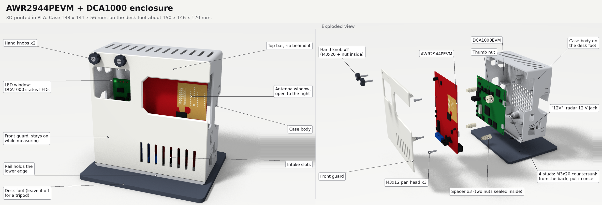
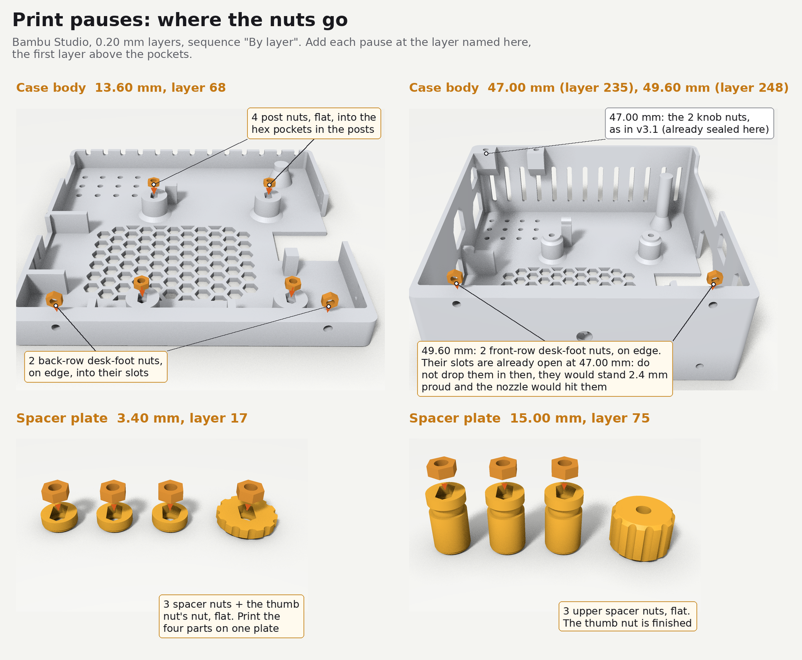
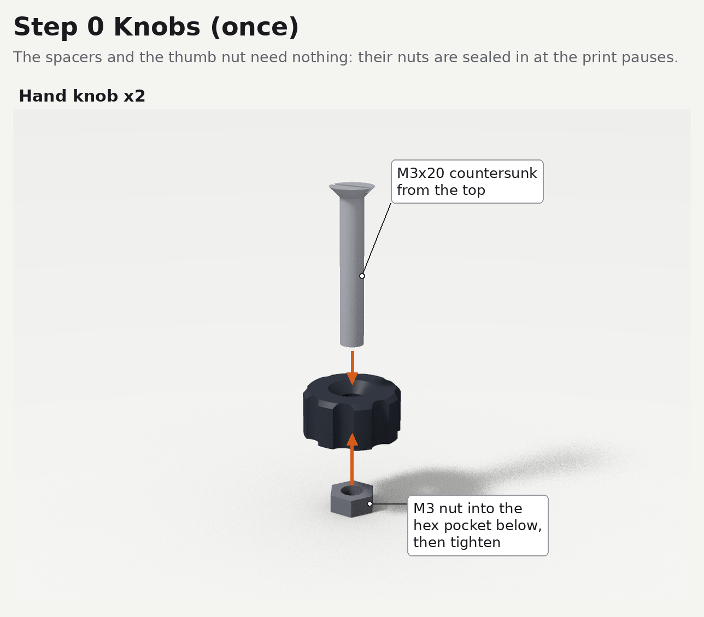
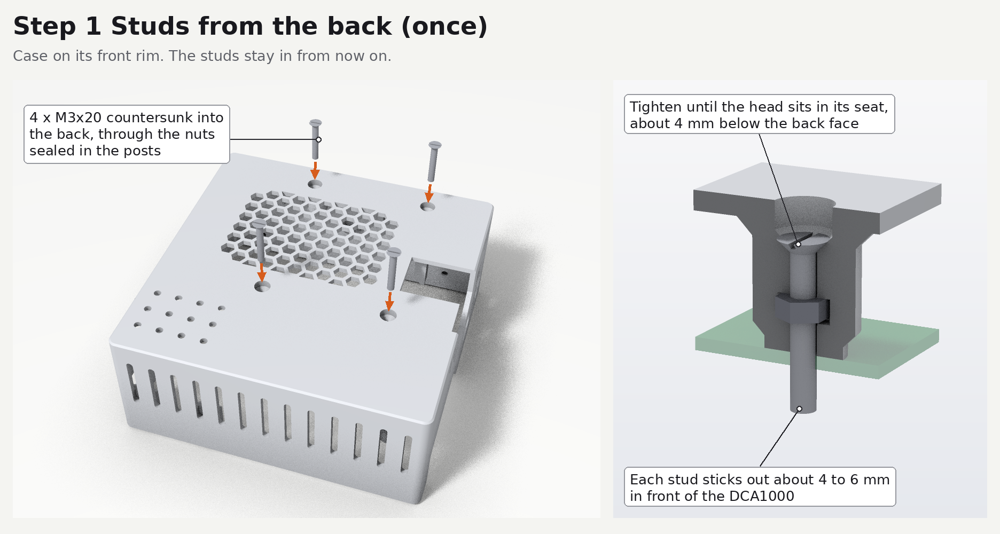
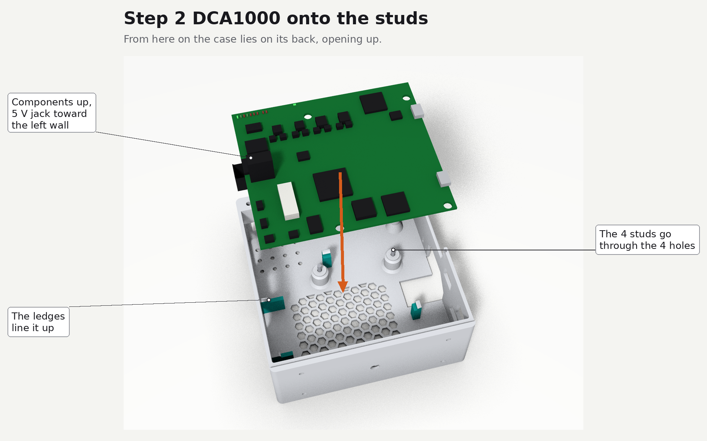
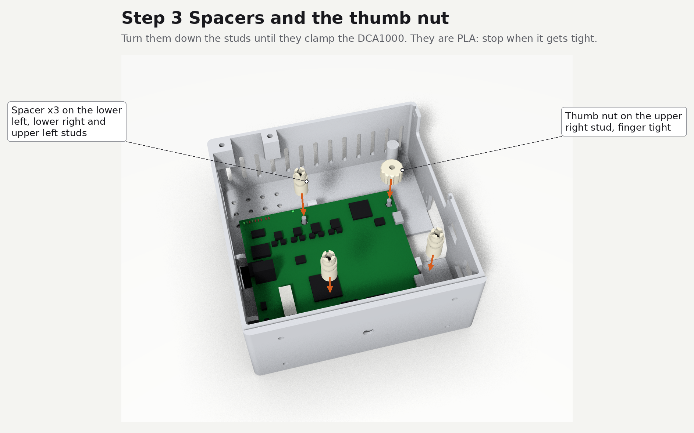
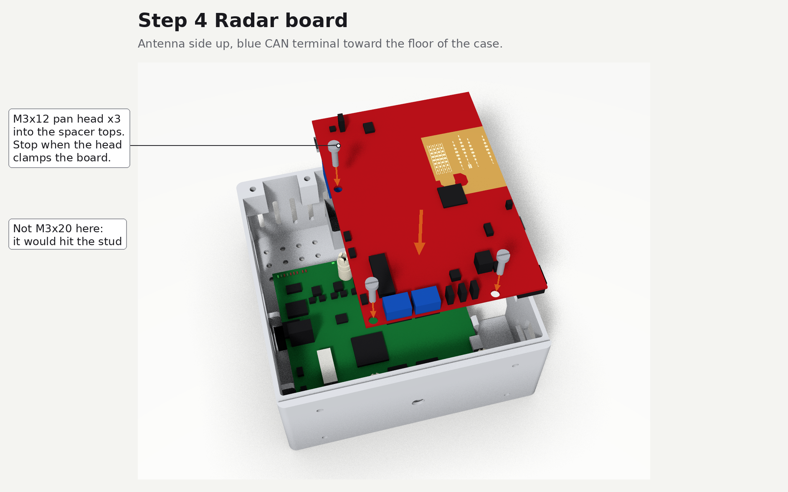
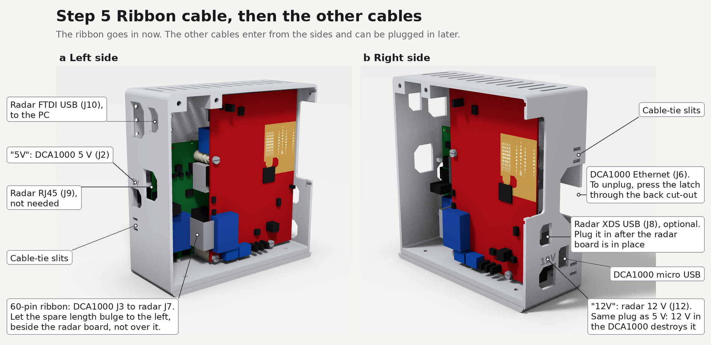
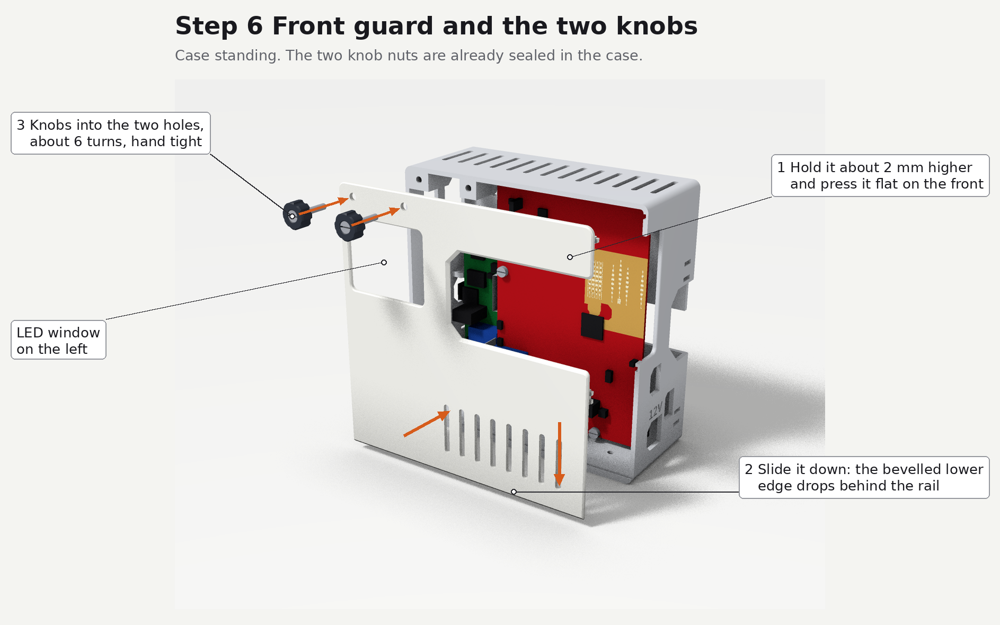
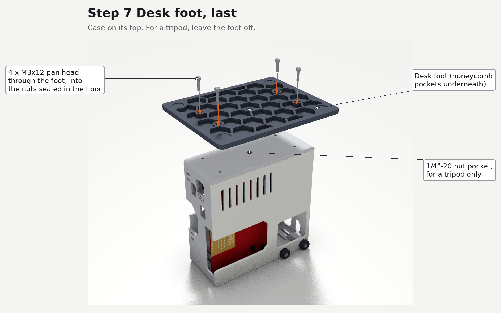

# AWR2944PEVM + DCA1000 enclosure

English | [简体中文](README.zh-CN.md)

A 3D-printed PLA case for a TI AWR2944PEVM radar board and a DCA1000EVM capture card.
The front guard stays on while you measure. Once four studs are fitted, every screw goes in from
the front.

This is v3.2, the latest version. Every earlier version is a git tag (`v1.0` to `v3.1`)
with its own files and instructions; the tag message says what changed.

## What it is

- The two boards stand one behind the other: the DCA1000 at the back, on 4 studs that stay in the
  case; the radar board in front, antenna facing out, on 3 printed spacers. They are 20 mm apart.
- Case 138 × 141 × 56 mm (width × height × depth). On the desk foot about 150 × 146 × 120 mm;
  without the foot, with the guard and knobs, 138 × 141 × 64 mm.
- Front guard: a 74 × 42 mm antenna window open to the right, so nothing sits in the antenna beam,
  and a 45 × 37 mm window on the left over the DCA1000 status LEDs. Two hand knobs hold the top left,
  two clips hook inside the right wall, and the lower edge sits behind a rail on the case.
- Every nut is sealed into the print at a print pause, so none can fall out.
- "5V" and "12V" are engraved next to the two power jacks: both take the same plug, and 12 V in the
  DCA1000 destroys it.
- Cooling: a honeycomb grid in the back, 13 slots in the top, 8 intake slots in the guard.
- Tripod: leave the desk foot off; a 1/4"-20 nut in the floor takes the tripod screw.

## Files

| Folder | Content |
| --- | --- |
| `stl/` | print files, already in print orientation |
| `stl/test_fit/` | optional dummy boards for a test fit |
| `step/` | STEP models of the parts, for editing in CAD (modelling frame, not print orientation) |
| `images/` | figures used in this README and in `design/` |
| `design/` | why the case is built this way |

## Print

| File | Print | Notes |
| --- | --- | --- |
| `stl/body_pause_at_13.60mm_47.00mm_49.60mm.stl` | 1 | three pauses to drop in 10 M3 nuts, see below |
| `stl/front_guard.stl` | 1 | |
| `stl/knob_x2.stl` | 2 | 4 walls, 100 % infill |
| `stl/spacer_x3_pause_at_3.40mm_15.00mm.stl` | 3 | on one plate with the thumb nut; two pauses |
| `stl/thumb_nut_pause_at_3.40mm.stl` | 1 | its nut goes in at the first spacer pause |
| `stl/desk_foot.stl` | 1 | not needed if the case only goes on a tripod |
| `stl/test_fit/*.stl` | 1 each | optional; each board is two halves, stacked flat face to flat face |

All files are already in print orientation: print them as imported, without rotating.

Settings (made for a Bambu Lab A1 with a 0.4 mm nozzle):

- 0.20 mm layers. Keep this height: the pause heights and the two bridging steps above each nut
  are sized for it.
- 3 walls, 15 % infill, no supports; knob 4 walls, 100 % infill. The spacer plate was test printed
  with the defaults and an outer brim.
- Print sequence "By layer": Bambu Studio offers no pauses "By object".
- Plain PLA. No silver, metal-filled or carbon-filled filament: the guard and the right wall sit
  next to the antenna.
- Print the spacer plate first. If the M3 nuts drop into the spacer pockets at the 3.40 mm pause,
  the nuts are the right size.

### Print pauses

After slicing, move the layer slider to each layer below and add a pause there. Each one is the first
layer above the pockets; at the pause the pockets are open on top.

| Part | Pause at | Layer | Drop in |
| --- | --- | --- | --- |
| case body | 13.60 mm | 68 | 4 nuts flat into the hex pockets in the posts; 2 nuts on edge into the back-row slots in the floor |
| case body | 47.00 mm | 235 | 2 nuts flat into the hex pockets on the two bosses at the top left, for the knobs |
| case body | 49.60 mm | 248 | 2 nuts on edge into the front-row slots in the floor |
| spacer plate | 3.40 mm | 17 | 1 nut flat into each of the 3 spacers and the thumb nut |
| spacer plate | 15.00 mm | 75 | 1 nut flat into each of the 3 spacers |

- The floor slots only take the nut one way: standing on its edge, sitting in the V at the bottom.
- The front-row floor slots are already open at the 47.00 mm pause. Leave them empty until 49.60 mm:
  a nut put in early stands 2.4 mm above the print and the nozzle hits it.
- Resume after each pause. The next layers close over the nuts. A faint line may show on the outer
  wall at a pause layer.

Save the sliced projects with the pauses as `.3mf` and print from them next time.

## Hardware

- M3×20 countersunk × 6: 4 studs, 2 in the knobs. Countersunk screws are measured including the
  head; check with calipers that they are 19.5 to 20.5 mm overall, since labels are often wrong.
- M3×12 pan head × 7: 3 for the radar board, 4 for the desk foot. Pan head means any head that sits
  on top (round, pan or cheese head), measured from under the head.
- M3 nut × 19, 5.5 mm across flats, at most 2.4 mm thick: 4 in the posts, 4 in the floor and 2 for
  the knobs, all sealed into the body; 6 in the spacers and 1 in the thumb nut, sealed in the same
  way; 2 in the knobs.
- 1/4"-20 UNC hex nut × 1, optional, for a tripod (11.1 mm across flats).
- 12 mm self-adhesive rubber feet × 4, optional, in the shallow recesses under the desk foot.

Also needed: the two boards and the 60-pin ribbon cable from the DCA1000 kit. The TI plastic standoffs
are not used: the boards must be 20 mm apart, or the radar board hits the guard and the side openings
no longer line up.

## Assembly

Step 1 is done once. After that the case lies on its back for steps 2 to 4, and every screw goes in
from the front.

### Step 0: knobs (once)

1. Knobs × 2: push an M3×20 countersunk into the knob from the side with the cone, put an M3 nut in
   the hex pocket on the other side and tighten with a screwdriver. Screw and knob then turn as one,
   with the screw sticking out about 14 mm.
2. Remove the metal feet TI fitted to the radar board: they take two of its mounting holes.

The spacers and the thumb nut need nothing: their nuts were sealed in at the print pauses.

### Step 1: studs (once)

1. Lay the case on its front rim.
2. Push an M3×20 countersunk into each of the 4 holes in the back, through the nut sealed in the post,
   and tighten until the head sits in its seat, about 4 mm below the back face.
3. They stay in from now on. Each stud now sticks out about 4 to 6 mm in front of where the DCA1000
   will sit.

### Step 2: DCA1000

1. Set the DCA1000 DIP switches first (TI SPRUJ22C, section 2.9); it is easiest before the board
   goes in.
2. Lay the case on its back, opening up.
3. Components up, 5 V jack toward the left wall, Ethernet toward the right: lower the board onto the
   4 studs. The ledges line it up.

### Step 3: spacers and the thumb nut

1. Spacers on the lower left, lower right and upper left studs: turn each one down the stud with a
   flat or Phillips screwdriver in the cross slot on top, until it clamps the DCA1000. Stop as soon as
   it gets tight: the spacer is PLA.
2. Thumb nut on the upper right stud, finger tight. The radar board has no hole there.

With the dummy boards, the upper left spacer rubs on the dummy's RJ45 block: the block is the outline
of the whole connector and is wider than the real one, which leaves 0.75 mm.

### Step 4: radar board

1. Set the radar board SOP jumpers first (TI SPRUJ22C, section 2.9).
2. Antenna side up, blue CAN terminal toward the floor of the case, so the antenna is near the top
   right corner: lower the board onto the 3 spacers.
3. Drive one M3×12 pan head through each hole into the upper nut of the spacer and stop when the head
   clamps the board. Do not use an M3×20 here: it would hit the stud.

### Step 5: ribbon cable and the other cables

1. Ribbon cable: one end into DCA1000 J3 (outside the left edge of the radar board), the other into
   radar J7 (lower left on its front). Let the spare length bulge to the left, beside the radar board,
   not over it.
2. The other cables enter through the side walls:

   | Cable | Plugs into | Enters through |
   | --- | --- | --- |
   | 5 V supply | DCA1000 J2 | left wall, lower rear window, marked "5V" |
   | micro USB to the PC | radar FTDI port J10 | left wall, upper front window (not the rear one) |
   | Ethernet to the PC | DCA1000 J6 | right wall, middle rear cut-out |
   | 12 V supply | radar J12 | right wall, lowest front window, marked "12V" |
   | USB, optional | radar XDS110 port J8 | right wall, front window; plug it in after the radar board is in |

3. Connect power first, then USB: TI notes that plugging USB in first can hold the board in reset.
4. To unplug the Ethernet cable, press its latch with a finger through the cut-out on the right of
   the back.
5. Cable ties through the slits low on both side walls keep the cables from pulling on the connectors.

The radar Ethernet port J9 and the two DCA1000 micro USB ports also have openings, but TI's capture
setup does not use them.

### Step 6: front guard

1. Stand the case up. LED window on the left, the two holes at the top left, ribs and clips inward.
   Hold the guard about 2 mm above its final position and press it flat on the front: the two clips
   on the right drop into the entry slots inside the right wall. Slide it down: the bevelled lower
   edge drops behind the rail and the clips slide under the slot edges.
2. Screw in the two knobs, about 6 turns each, hand tight.

To take the guard off, unscrew the knobs, push the guard up 2 mm so the clips come back to the entry
slots, and lift it away. The DIP switches, jumpers and CAN terminal are all on the front of the boards
and reachable with the guard off.

If a knob spins without tightening, tighten the screw inside it again, or add a drop of
cyanoacrylate glue.

### Step 7: desk foot, or a tripod

Desk foot: turn the case onto its top, lay the foot on the floor of the case and drive 4 M3×12 pan
heads through the foot into the sealed floor nuts. The heads sit in the counterbores under the foot.

Tripod instead: leave the foot off and stand the case up. Put the 1/4" nut into the large pocket in
the middle of the floor, then screw the tripod or quick-release plate in from below. With both boards
in, the pocket is reached with tweezers holding the nut flat: in on the left of the radar board, back
between the two boards, then right and down onto the pocket. Take the nut out again before you lay
the case on its back.

### Taking it apart

Reverse steps 2 to 6, all from the front; the studs stay in. If a spacer turns with its radar screw
when you undo it, lift it out with the board and separate them on the bench.

## Design notes

- [design/v3.2-changes.md](design/v3.2-changes.md): studs, round spacers and sealed floor nuts, so
  that every screw goes in from the front.
- [design/radar-assessment.md](design/radar-assessment.md): whether the case blocks or reflects the
  antenna beam.
- [design/v3.1-changes.md](design/v3.1-changes.md): the reasons behind each change in v3.1, and
  where a logo fits on the front guard.

## License

Copyright Mengyuan Liu 2026.

The hardware design files (`stl/`, `step/`) describe Open Hardware and are licensed under the
CERN-OHL-P v2. You may redistribute and modify them and make products using them under the terms of
the CERN-OHL-P v2 ([LICENSE](LICENSE), https://ohwr.org/cern_ohl_p_v2.txt). They are distributed
WITHOUT ANY EXPRESS OR IMPLIED WARRANTY, INCLUDING OF MERCHANTABILITY, SATISFACTORY QUALITY AND
FITNESS FOR A PARTICULAR PURPOSE. Please see the CERN-OHL-P v2 for applicable conditions.

Source location: https://github.com/triagram/awr2944p-dca1000-case

The documentation and images are licensed under
[CC BY 4.0](https://creativecommons.org/licenses/by/4.0/).

## References

- TI design files for the board outlines, holes, components and LEDs:
  [DCA1000EVM (SPRR350)](https://www.ti.com/lit/zip/SPRR350),
  [AWR2944EVM (SPRR440)](https://www.ti.com/lit/zip/SPRR440),
  [AWR2944PEVM (SPRR507)](https://www.ti.com/lit/zip/SPRR507).
- [AWR2944EVM / AWR2944PEVM user guide (SPRUJ22C)](https://www.ti.com/lit/ug/spruj22c/spruj22c.pdf):
  connector names, the switch and jumper settings for the DCA1000 (section 2.9).

## Acknowledgements

Thanks to kalvik for the
[TI mmWave Radar IWR/AWR BOOST, DCA1000 and Camera/Kinect Case/Mount](https://www.thingiverse.com/thing:3780598)
(CC BY-SA), the case this project first looked at. This case is a new design, not a remix of it.
