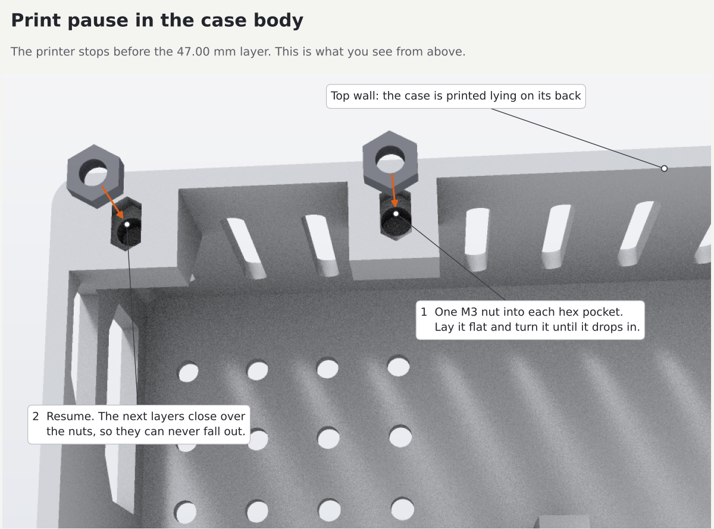

# AWR2944PEVM + DCA1000 外壳

[English](README.md) | 简体中文

3D 打印的 PLA 外壳，装 TI 的 AWR2944PEVM 雷达板和 DCA1000EVM 采集卡。测量时前护板不用摘。

这是最新的 v3.1。以前的每个版本都是一个 git tag（`v1.0` 到 `v3.0`），有各自的文件和说明；改了什么写在 tag 说明里。

## 是什么样的

- 两块板立着前后叠放：DCA1000 在后，靠在 4 根立柱上；雷达板在前，天线朝外。两板间距 20 mm。
- 外壳 138 × 141 × 56 mm（宽 × 高 × 深）。放在桌面底座上约 150 × 146 × 120 mm；拆掉底座、算上护板和旋钮是 138 × 141 × 64 mm。
- 前护板：右边是 74 × 42 mm 的天线窗，向右敞开，天线波束里没有任何遮挡；左边是 45 × 37 mm 的窗，正对 DCA1000 的状态灯。左上角两个手拧旋钮，右边两个滑扣卡在右墙内侧，下边插在外壳的导轨后面。
- 散热：背板一块蜂窝格栅，顶壁 13 条散热槽，护板上 8 条进风槽。
- 三脚架：拆掉桌面底座，底壁里的 1/4"-20 螺母接三脚架的螺丝。

## 文件

| 文件夹 | 内容 |
| --- | --- |
| `stl/` | 打印文件，已经摆成打印朝向 |
| `stl/test_fit/` | 试装用的假体板（可选） |
| `step/` | 各零件的 STEP 模型，用 CAD 修改时用（建模坐标，不是打印朝向） |
| `images/` | 本说明里的图 |
| `design/` | 为什么这样设计 |

## 打印

| 文件 | 打印数量 | 说明 |
| --- | --- | --- |
| `stl/body_pause_at_47.00mm.stl` | 1 | 打到 47.00 mm 暂停，放 2 颗 M3 螺母，见下面 |
| `stl/front_guard.stl` | 1 | |
| `stl/knob_x2.stl` | 2 | 墙 4 层，填充 100% |
| `stl/spacer_x3.stl` | 3 | 墙 4 层，填充 100% |
| `stl/desk_foot.stl` | 1 | 只用三脚架可以不打 |
| `stl/test_fit/*.stl` | 各 1 | 可选；每块板是两个半片，平面对平面叠起来 |

所有文件都已经摆成打印朝向，导入后直接打，不要旋转。

打印设置（按 Bambu Lab A1、0.4 mm 喷嘴设定）：

- 层高 0.20 mm，必须保持：螺母坑和垫柱槽上方的搭桥台阶是按这个层高设计的。
- 墙 3 层，填充 15%，不开支撑，不加 brim；旋钮和垫柱墙 4 层、填充 100%。
- 用普通纯色 PLA，不要用银色、含金属粉或碳纤维的耗材：护板和右墙就在天线旁边。
- 先打垫柱：M3 螺母能推进垫柱的槽，螺母尺寸就没问题。

### 外壳本体的打印暂停

1. 切片后，把层滑块拖到 47.00 mm 那一层（0.20 mm 层高时是第 235 层，螺母坑上方的第一层），在这里添加暂停。层高不是 0.20 mm 时，选第一层高于 46.8 mm 的那一层。
2. 打印机停下时，左上角两个凸台顶上各露出一个六角坑。各放进一颗 M3 螺母，平放，转一下就会落到底。
3. 继续打印。上面几层会把螺母封住，以后拆旋钮时螺母也掉不出来。暂停那一层的外壁上可能留一条很细的线。

把加好暂停的切片项目另存成 `.3mf`，下次直接打它。

## 五金

- M3×20 沉头 × 6：背面 4 颗，旋钮里 2 颗。沉头的长度连头一起量；买来先用卡尺量一下，总长应在 19.5 到 20.5 mm。标签和实物对不上的情况不少见，长了会顶到另一颗螺丝。
- M3×12 平头 × 7：雷达板 3 颗，桌面底座 4 颗。平头指头露在外面的螺丝（圆头、盘头、圆柱头都行），长度从头的下面量。
- M3 螺母 × 15：底壁 4 个，DCA1000 第 4 个孔 1 个，旋钮里 2 个，打印暂停时封进外壳 2 个，3 根垫柱里各 2 个。
- 1/4"-20 UNC 六角螺母 × 1，可选，上三脚架才要（对边 11.1 mm）。
- 12 mm 自粘橡胶脚垫 × 4，可选，贴在底座底面的浅槽里。

另外就是两块板和 DCA1000 套件里的 60 针排线。TI 自带的塑料柱用不上：两板间距必须是 20 mm，否则雷达板会顶到护板，侧面的开口也会错位。

## 安装

外壳立在桌上、开口朝自己装。第 1 步必须在放板之前做。

### 第 0 步：准备小件（只做一次）

1. 旋钮 2 个：M3×20 沉头从有锥坑的一面穿进旋钮，另一面的六角坑里放一个 M3 螺母，用螺丝刀拧紧。之后螺丝和旋钮是一体的，螺丝伸出约 14 mm。
2. 垫柱 3 根：两个侧面的槽里各推进一个 M3 螺母，推到底。从细头的孔往下看，两个螺母的孔应该对正。
3. 拆掉雷达板上 TI 装的金属脚，它们占着雷达板的两个安装孔。

### 第 1 步：底壁螺母和桌面底座

1. 4 个 M3 螺母放进底壁内侧的 4 个小六角坑，沉到底。要上三脚架的话，1/4" 螺母放进中间的大六角坑。
2. 外壳放在底座上，4 颗 M3×12 从底座下面穿上来拧进螺母。螺丝头藏在底座下面的沉孔里。
3. 从下面拧时，把外壳挪到桌边，让要拧的那个角伸出桌外；或者在坑口贴一小块胶带，把外壳倒过来拧。

后面两个坑在 DCA1000 背后，装了板就够不到了，所以这一步必须最先做。

### 第 2 步：DCA1000

1. 先按 TI 说明拨好 DCA1000 的拨码开关（SPRUJ22C 第 2.9 节），放进去之前拨最方便。
2. 元件面朝前、5 V 插座朝左、网口朝右，立着放进去。下边落在底部两个台阶上，左、上、右三面的定位台阶把它对正，往后靠住 4 根立柱，4 个孔就对准了。
3. 板子老往前倒，就在底座前沿下面垫一本 1 到 2 cm 厚的书，让外壳稍微后仰。

### 第 3 步：垫柱和背面 4 颗螺丝

左下、右下、左上 3 个孔装垫柱。右上第 4 个孔只装螺丝和螺母，雷达板在这里没有孔。

1. 一只手把垫柱按在孔上：平的一头贴板、细头朝自己，槽口朝左右，两侧的平面保持水平，螺母就不会掉出来。这样也同时按住了板子。
2. 另一只手从背面穿一颗 M3×20 沉头，拧到垫柱贴紧板面、手感明显变紧就停。垫柱是 PLA，不要用死力。
3. 右上第 4 个孔：背面同样穿一颗 M3×20 沉头，用钳子捏住板子正面的 M3 螺母拧紧。

用假体板试装时，左上角那根垫柱一定按第 1 点的方向放：假体背面的网口方块比真板宽，只有这个方向穿得过去。

### 第 4 步：雷达板

1. 先按 TI 说明设好雷达板的 SOP 跳线（SPRUJ22C 第 2.9 节）。
2. 天线面朝自己、蓝色 CAN 端子在下、天线在右上，放到 3 根垫柱上。
3. 每个孔拧一颗 M3×12 平头，拧进垫柱里的上螺母，螺丝头压紧板子就停。这里不要用 M3×20，会顶到背面那颗螺丝。

### 第 5 步：排线和其他线

1. 排线一头插 DCA1000 的 J3（在雷达板左边外侧），另一头插雷达板正面左下的 J7。多出来的长度让它在雷达板左边拱起，不要压在雷达板正面。
2. 其他线从两侧壁进：

   | 线 | 插到 | 从哪进 |
   | --- | --- | --- |
   | 5 V 电源 | DCA1000 的 J2 | 左侧壁靠后、偏下的窗口 |
   | micro USB，到电脑 | 雷达板 FTDI 口 J10 | 左侧壁上部靠前的窗口（靠后那个不用） |
   | 网线，到电脑 | DCA1000 的 J6 | 右侧壁中部靠后的缺口 |
   | 12 V 电源 | 雷达板的 J12 | 右侧壁最下面靠前的窗口 |
   | USB，可选 | 雷达板 XDS110 口 J8 | 右侧壁前部的窗口，雷达板装好后再插 |

3. 先接电源，再插 USB。TI 提醒先插 USB 可能让板子卡在复位状态。
4. 拔网线时，从背板右侧的开口伸手指按住网线卡扣。
5. 两侧壁下部有扎带孔，用细扎带固定线，免得拉扯插座。

雷达板的网口 J9 和 DCA1000 的两个 micro USB 也有开口，但 TI 的采集接法里不用。

### 第 6 步：前护板

1. LED 窗在左、两个孔在左上角、筋和滑扣朝里。比最终位置高约 2 mm 贴到外壳正面并压平，右边两个滑扣会落进右墙内侧的入口槽；再往下滑到底，下沿的斜边卡到导轨后面，滑扣同时滑到槽沿下面。
2. 两个旋钮对准孔拧上，各约 6 圈，手拧紧即可。

拆护板：拧下两个旋钮，护板往上推 2 mm，滑扣退回入口槽，再向外拿开。拨码开关、跳线、CAN 端子都在两块板正面，取下护板就能操作。

旋钮空转的话，把旋钮里的螺丝再拧紧一下，或者点一滴 502 胶。

### 上三脚架

拧下 4 颗螺丝、拿掉桌面底座，三脚架或快装板的螺丝拧进底壁中间的 1/4" 螺母。外壳立着时，底壁里的 4 个 M3 螺母会留在坑里。

## 设计说明

- [design/radar-assessment.zh-CN.md](design/radar-assessment.zh-CN.md)：外壳会不会挡住或反射天线波束。
- [design/v3.1-changes.zh-CN.md](design/v3.1-changes.zh-CN.md)：v3.1 每项改动的原因。

## 许可证

Copyright Mengyuan Liu 2026.

硬件设计文件（`stl/`、`step/`）按 CERN-OHL-P v2 授权，你可以按它的条款再分发、修改这些文件，并用它们制作产品。具有法律效力的是英文原文，见 [LICENSE](LICENSE) 和 [README.md](README.md) 的 License 一节。

源文件地址：https://github.com/triagram/awr2944p-dca1000-case

文档和图片按 [CC BY 4.0](https://creativecommons.org/licenses/by/4.0/deed.zh-hans) 授权。

## 参考资料

- 板子的外形、孔位、元件和 LED 位置来自 TI 设计文件：[DCA1000EVM（SPRR350）](https://www.ti.com/lit/zip/SPRR350)、[AWR2944EVM（SPRR440）](https://www.ti.com/lit/zip/SPRR440)、[AWR2944PEVM（SPRR507）](https://www.ti.com/lit/zip/SPRR507)。
- [AWR2944EVM / AWR2944PEVM 用户指南（SPRUJ22C）](https://www.ti.com/lit/ug/spruj22c/spruj22c.pdf)：接口编号，配合 DCA1000 的开关和跳线设置（第 2.9 节）。
