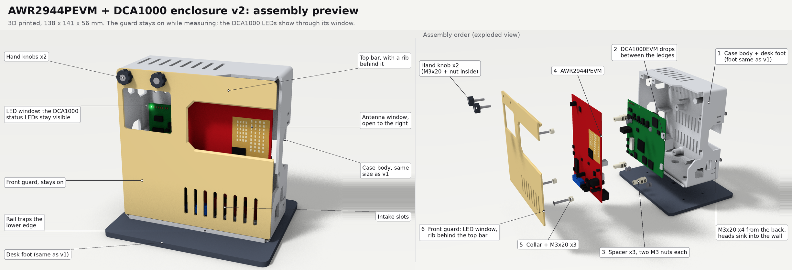
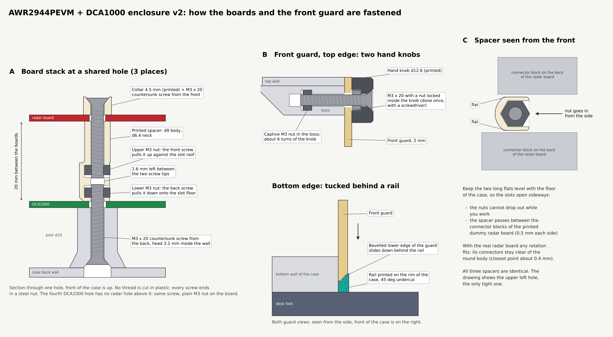
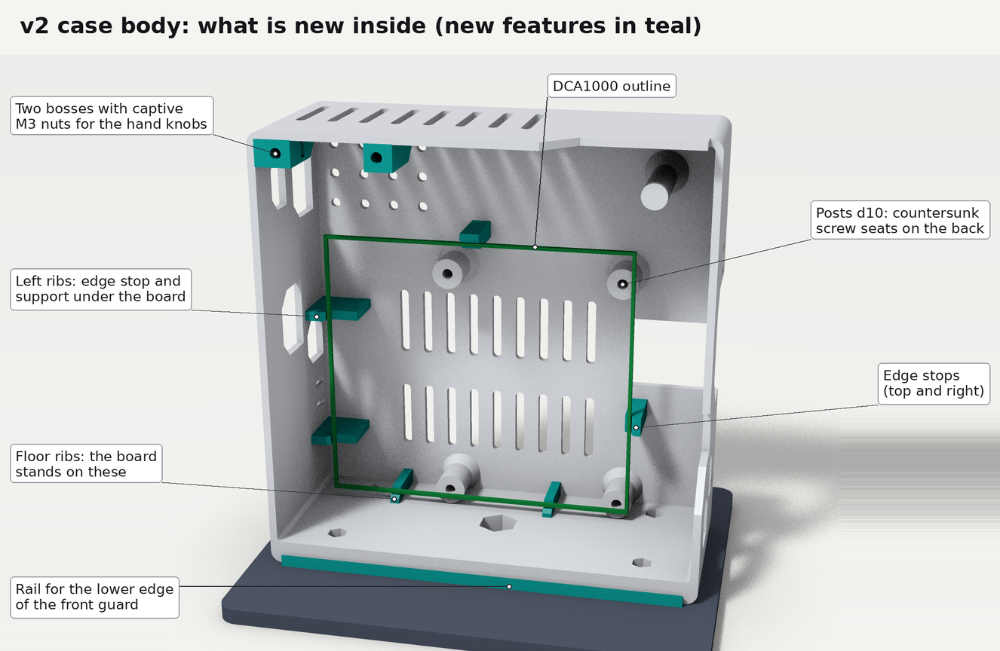
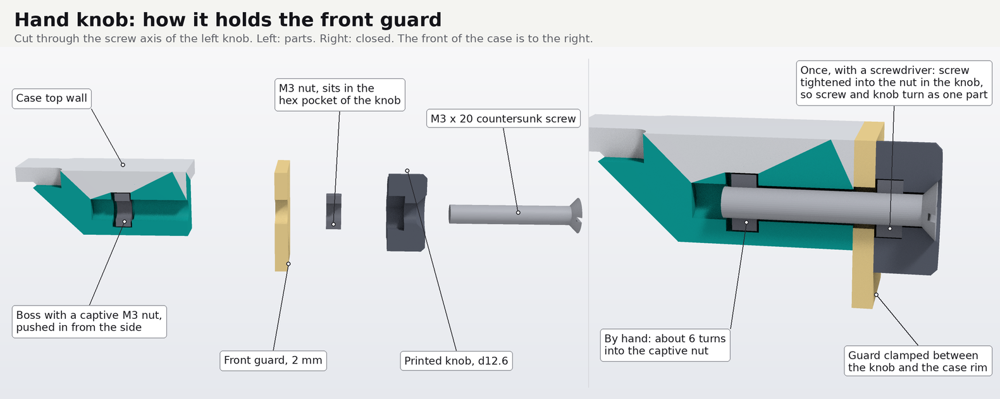

# AWR2944PEVM + DCA1000 外壳

[English](README.md) | 简体中文

3D 打印的 PLA 外壳，装 TI 的 AWR2944PEVM 雷达板和 DCA1000EVM 采集卡。测量时前护板不用摘。

这是 v2.0。最新版本在 `main` 分支上；每个版本都是一个 git tag，有各自的文件和说明，改了什么写在 tag 说明里。

## 是什么样的

- 两块板立着前后叠放：DCA1000 在后，靠在 4 根立柱上；雷达板在前，天线朝外。两板间距 20 mm。
- 外壳 138 × 141 × 56 mm（宽 × 高 × 深），底边前沿的导轨再高出 2.3 mm；放在桌面底座上约 150 × 146 × 120 mm。
- 前护板：右边是 74 × 42 mm 的天线窗，向右敞开；左边是 45 × 37 mm 的窗，正对 DCA1000 的状态灯。左上角两个手拧旋钮，下边插在导轨后面。
- 每颗螺丝都拧进钢螺母，塑料上不攻螺纹。
- 散热：背板 18 条长孔，顶壁 8 条散热槽，护板上 8 条进风槽。
- 三脚架：拆掉桌面底座，底壁里的 1/4"-20 螺母接三脚架的螺丝。

## 文件

| 文件夹 | 内容 |
| --- | --- |
| `stl/` | 打印文件，已经摆成打印朝向 |
| `stl/test_fit/` | 试装用的假体板（可选） |
| `images/` | 本说明里的图 |

## 打印

| 文件 | 打印数量 | 说明 |
| --- | --- | --- |
| `stl/body.stl` | 1 | |
| `stl/front_guard.stl` | 1 | |
| `stl/knob_x2.stl` | 2 | 墙 4 层，填充 100% |
| `stl/spacer_x3.stl` | 3 | 墙 4 层，填充 100% |
| `stl/collar_x3.stl` | 3 | 墙 4 层，填充 100% |
| `stl/desk_foot.stl` | 1 | 只用三脚架可以不打 |
| `stl/test_fit/*.stl` | 各 1 | 可选；每块板是两个半片，平面对平面叠起来 |

所有文件都已经摆成打印朝向，导入后直接打，不要旋转。

打印设置（按 Bambu Lab A1、0.4 mm 喷嘴设定）：

- 层高 0.20 mm，必须保持：垫柱和外壳两个凸台里的螺母槽上方有搭桥台阶，是按这个层高设计的。
- 墙 3 层，填充 15%，不开支撑，不加 brim；小件墙 4 层、填充 100%。
- 先打小件，拿螺母试一下：螺母能推进垫柱的槽，外壳上的槽也就没问题。

## 五金

- M3×20 沉头 × 9：背面 4 颗，雷达板 3 颗（配套环），旋钮里 2 颗。
- M3×10 圆头 × 4：桌面底座。
- M3 螺母 × 15：底壁 4 个，DCA1000 第 4 个孔 1 个，旋钮里 2 个，外壳左上角两个凸台里 2 个，3 根垫柱里各 2 个。
- 1/4"-20 UNC 六角螺母 × 1，可选，上三脚架才要（对边 11.1 mm）。
- 12 mm 自粘橡胶脚垫 × 4，可选，贴在底座底面。

另外就是两块板和 DCA1000 套件里的 60 针排线。工具只要一把和沉头螺丝配套的螺丝刀。

## 安装

### 准备（只做一次）

1. 旋钮 2 个：M3×20 从有锥坑的一面穿进旋钮，另一面的六角坑里放一个 M3 螺母，用螺丝刀拧紧。之后螺丝和旋钮是一体的，螺丝伸出约 14 mm。
2. 垫柱 3 根：两个侧面的槽里各推进一个 M3 螺母，推到底。从柱顶的孔往下看，两个螺母的孔应该对正。
3. 外壳左上角两个凸台：各从侧面的槽推进一个 M3 螺母（左边凸台槽口朝右，右边的朝左）。两块板装好以后也够得到。
4. 底壁螺母和桌面底座：4 个 M3 螺母放进底壁内侧的 4 个小六角坑（要上三脚架的话，1/4" 螺母放进中间的大六角坑），再用 4 颗 M3×10 从底座下面穿上来拧进去。必须在放板之前做，装了板就够不到后面两个坑了。
5. 拆掉雷达板上 TI 装的金属脚，它们占着雷达板的两个安装孔。

### 步骤

外壳立在桌上、开口朝自己装。

1. DCA1000：元件面朝前、5 V 插座朝左，立着放进去，落在底部两个台阶上，往后靠住 4 根立柱，4 个孔就对准了。
2. 左下、右下、左上 3 个孔：一只手把垫柱按在孔上（粗的一头贴板，槽口朝左或朝右），另一只手从背面穿 M3×20，拧到螺丝带上垫柱里的下螺母、垫柱贴紧板面为止。手感明显变紧就停。
3. 右上第 4 个孔（雷达板在这里没有孔）：背面穿 M3×20，拧进放在板子正面的螺母。
4. 雷达板：天线朝前、CAN 端子在下，放在 3 根垫柱的细颈上。每个孔放一个套环（锥坑朝外），穿 M3×20 拧进上螺母，套环压住板子就停。如果没压紧螺丝就拧不动了，是顶到了背面那颗螺丝（漏了套环，或者螺丝比 20 mm 长），不要硬拧。
5. 排线：DCA1000 的 J3 接雷达板正面左下的 J7。
6. 接线：雷达板 12 V（J12）和 XDS USB（J8）从右侧进；雷达板 FTDI USB（J10）从左上的窗口进；DCA1000 的 5 V 从左侧窗口进，网线从右侧缺口进。
7. 装前护板，见下面。

垫柱的方向：垫柱中段两个长平面保持水平，槽口就朝左右。这样螺母不会掉出来；在左上角的孔，垫柱也正好从假体雷达板背面两个插座方块之间穿过去。装真板时转到任何角度都可以。

第 1、2 步嫌板子老往前倒，就在底座前沿下面垫一本 1 到 2 cm 厚的书，让外壳稍微后仰。

### 前护板

1. LED 窗在左、两个孔在左上角、筋朝里。比最终位置高约 2 mm 贴到外壳正面，再往下滑到底，下沿的斜边就卡到导轨后面了。
2. 两个旋钮对准孔拧上，各约 6 圈，手拧紧即可。

拆护板：拧下两个旋钮，护板往上提 2 mm，向外拿开。旋钮拧下来以后，凸台里的两个螺母只是放在槽里，外壳侧放时可能滑出来，可以在槽口贴一小块胶带。旋钮空转的话，把旋钮里的螺丝再拧紧一下，或者点一滴 502 胶。

## 许可证

Copyright Mengyuan Liu 2026.

硬件设计文件（`stl/`）按 CERN-OHL-P v2 授权，你可以按它的条款再分发、修改这些文件，并用它们制作产品。具有法律效力的是英文原文，见 [LICENSE](LICENSE) 和 [README.md](README.md) 的 License 一节。

源文件地址：https://github.com/triagram/awr2944p-dca1000-case

文档和图片按 [CC BY 4.0](https://creativecommons.org/licenses/by/4.0/deed.zh-hans) 授权。

## 参考资料

- 板子的外形、孔位、元件和 LED 位置来自 TI 设计文件：[DCA1000EVM（SPRR350）](https://www.ti.com/lit/zip/SPRR350)、[AWR2944EVM（SPRR440）](https://www.ti.com/lit/zip/SPRR440)、[AWR2944PEVM（SPRR507）](https://www.ti.com/lit/zip/SPRR507)。
