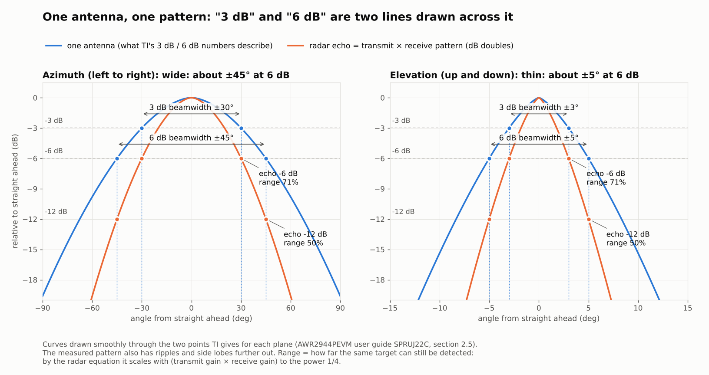

# Does the case affect the radar signal?

English | [简体中文](radar-assessment.zh-CN.md)

Assessment of 2026-10-20 of the right wall and the two guard clips added in v3.0. It compares v2.1
with the draft of v3.0, whose right wall ended in a 45° top, and led to the vertical drop that v3.0
was released with.

## Summary

**Inside TI's main beam (6 dB: azimuth ±45°, elevation ±5°), the right wall and the two clips neither
block the signal nor reflect energy into it. No measurable difference is expected.** The new material
is at least 31° from the edge of the main beam, much further than the lower edge of the guard's antenna
window (17.5°), which has been there since v2.0.

The only effect found was in the draft, at the lower right edge of the field of view: the 45° top of
the right wall between y 55 and 72 mm acted like a small mirror and turned a little of the energy the
antenna sends steeply down and to the right back toward the front. With the most conservative estimate
this gave a ripple of at most 0.6 dB peak to peak inside the 6 dB beam, and at most 1.7 dB inside a
widened ±60° × ±20° region; both are smaller than the same estimate gives for parts that were already
there. A vertical drop instead of the 45° top removes that path and changes nothing about the clips,
the assembly or the clip test piece, so v3.0 was released with it.

Inside the main beam there is nothing to worry about, and with the vertical drop the calculations find
no new effect. Only a measurement can confirm it; the last section describes one. It has not been done.

| Check | Result | Basis |
| --- | --- | --- |
| Line of sight (35 points, 32,041 directions each) | no newly blocked direction in the 6 dB beam or in ±60° × ±20°; all newly blocked directions are below −10° elevation and right of 28° azimuth | ray casting |
| Angle to the main beam | new material at least 31°; lower edge of the guard window 17.5° | ray casting |
| First Fresnel zone | 6 dB beam: 1.48 R1 cleared (1.85 R1 with the vertical drop), guard window lower edge 0.81 R1; ±60° × ±20°: 0.61 R1 (0.65 R1 with the vertical drop); all at least 0.6 R1 | ITU-R P.526 |
| Reflection into the view | only from the 45° top: ripple bound 0.2 to 0.6 dB in the 6 dB beam, 1.1 to 1.7 dB in ±60° × ±20°; 0 with the vertical drop | geometric optics |
| Material | PLA εr 2.45 to 2.96, tanδ about 0.01, about −12 dB from one surface; the new parts are not in front of the antenna, so the thickness rule does not apply | 4 measurement papers, TI SWRA705 |
| Measurement | not done | R&S, TI SPRACX7 |

## The antenna's beam

The AWR2944EVM / AWR2944PEVM user guide (TI SPRUJ22C, section 2.5) gives a peak antenna gain of 13 dBi
(76 to 81 GHz); azimuth beamwidth about ±30° at 3 dB and ±45° at 6 dB; elevation about ±3° at 3 dB and
±5° at 6 dB. That section applies to both the EVM and the PEVM.

The region kept clear in this check is widened to ±60° in azimuth and ±20° in elevation: 15° more than
the 6 dB width in azimuth and four times it in elevation. TI gives no pattern beyond the 6 dB width,
so this margin is a conservative choice.

The antenna position comes from the antenna copper in the PEVM PCB files (PROC194A): in case
coordinates x 90.45 to 120.45 mm and y 76 to 97.25 mm, on the front of the radar board (z 40.6 mm).
The checks below use 35 evenly spaced points on that area as sources.

## What the antenna sees

Method: from each of the 35 points (7 across, 5 down), rays in 1° steps from −89° to 89° in both
azimuth and elevation, 32,041 per point, intersected with the case body and guard of v2.1 and of the
v3.0 draft, using the print STL files without simplification.

- Inside TI's 6 dB beam, no ray is blocked in either version.
- Inside the widened ±60° × ±20° region, both versions block the same 212 rays, all at the lower edge
  of the guard's antenna window (there since v2.0), which reaches into the lower right corner of the
  region. The draft adds none.
- The directions the draft newly blocks are all below −10° elevation and right of 28° azimuth. With the
  vertical drop, only those below −29° elevation remain.
- The new material comes no closer than 31° to the edge of the 6 dB beam and 10° to the edge of the
  ±60° × ±20° region. For comparison, the lower edge of the guard window is only 17.5° from the 6 dB
  beam: the new wall is further from the main beam than parts that were already there.

## Near field: Fresnel zone and reflections

A ray check only answers whether something is in the way. The case walls are 1 to 5 cm from the
antenna, and at that distance two more things matter: the room a wave needs to pass an edge (the first
Fresnel zone), and energy that parts reflect back into the view.

### First Fresnel zone

ITU-R P.526: at distance d from the source, the first Fresnel zone radius is R1 ≈ √(λd) (for a target
much further than d). With no obstacle inside this ellipsoid the path counts as line of sight and
diffraction can be ignored; the engineering rule is to clear at least 0.6 R1. At the low end of the
band, 76 GHz (λ = 3.94 mm, the largest R1), d = 10 to 45 mm gives R1 = 6.3 to 13.3 mm.

Calculation: about 40,000 points on the surface of the new material; for each of the 35 antenna points,
the perpendicular distance h to the nearest ray inside the region and the distance d along that ray;
the smallest h / R1.

| Region | New material, draft (45° top) | New material, vertical drop (v3.0) | For comparison: existing parts |
| --- | --- | --- | --- |
| TI 3 dB beam | 1.86 R1 | 2.28 R1 | 1.03 R1 |
| TI 6 dB beam | 1.48 R1 | 1.85 R1 | 0.81 R1 (lower edge of the guard window) |
| ±60° × ±20° | 0.61 R1 | 0.65 R1 | reaches into the region |

All clear 0.6 R1, so by ITU-R P.526 there is no diffraction loss. The tightest point (0.61 R1) is the
upper corner of the full-height part of the right wall, and only for the outermost corner of the region
(azimuth 60°, elevation −20°). This rule is made for far-field links: the antenna is about 37 mm wide,
its far field starts at about 0.7 m, and the case is in the near field. The numbers are for comparing
parts, not exact losses.

### Reflections

Method: geometric optics. Each of the 35 antenna points radiates with a cos θ to cos² θ pattern (θ from
the board normal; cos θ is wider than a real patch antenna and overestimates the energy that reaches the
walls). Each ray reflects specularly at the first surface it meets, with the reflectance of a single
PLA surface (εr 2.7) in the stronger of the two polarisations (TE). The energy reflected into each
region is binned in 5° × 5° cells and compared with the direct energy in the same cell. The strongest
cell gives an upper bound on the ripple, assuming the reflected and direct waves add fully in phase:
peak-to-peak ripple = 20 lg((1 + a)/(1 − a)), where a is the amplitude ratio.

| | Share of antenna power intercepted | 6 dB beam: strongest cell / ripple bound (peak to peak) | ±60° × ±20°: strongest cell / ripple bound |
| --- | --- | --- | --- |
| Existing parts (v2.1) | 14 % to 21 % | −23 to −19 dB / 1.2 to 1.9 dB | −19 to −18 dB / 2.0 to 2.3 dB |
| New material, draft (45° top) | 0.3 % to 0.9 % | −40 to −29 dB / 0.2 to 0.6 dB | −24 to −20 dB / 1.1 to 1.7 dB |
| New material, vertical drop (v3.0) | 0.2 % to 0.6 % | nothing reflected in / 0 | nothing reflected in / 0 |

The two numbers in each cell are for the cos² θ and cos θ patterns. With εr 2.45 or 2.96 each value
changes by less than 0.5 dB. The bound for the existing parts is larger than for the new material,
which shows the bound is conservative: it is for comparison, not a value expected in a measurement.

All the reflection from the new material comes from one surface: the 45° top of the right wall between
y 55 and 72 mm. Rays the antenna sends steeply down and to the right (28° to 78° below) hit the slope
and turn forward; the part that enters the region lands at azimuth 8° to 60° and elevation 0° to −20°.
The bounced ray passes 9 mm outside the right edge of the guard, so the guard does not stop it. The
inner face of the wall and the faces of the two clips are parallel to the beam or face backward, so
their reflections stay out of the view. With a vertical drop, these steep rays leave over the low wall
and the reflection path is gone.

**Decision**: the right wall drops vertically at y 53.7 mm instead of the 45° top between y 55 and
72 mm. 53.7 mm is the lower edge of the lower clip's second entry slot (with the 0.3 mm slot
clearance), so no thin sliver is left at the end of the wall. It uses 0.38 cm³ less material; the clips,
fitting the guard and the loads on it are unchanged, and the clip test piece stays valid. Recomputed
after the change: 1.85 R1 cleared in the 6 dB beam, 0.65 R1 in ±60° × ±20°, no reflection into the
view, and all newly blocked directions below −29° elevation.

## What PLA is near 77 GHz

| Source | Frequency | εr | tanδ | Note |
| --- | --- | --- | --- | --- |
| Işık et al., Aalto University (arXiv preprint, 2026) | 70 to 110 GHz | 2.45 to 2.75 (7 colours of Ultimaker PLA) | silver PLA above 0.02 at the high end | no anisotropy observed; not peer reviewed |
| Felício, Fernandes, Costa (ICECom 2016) | 0.5 to 60 GHz | about 2.75 ± 0.05 (normal to the print plane), about 2.96 (parallel) | (1.1 ± 0.2) × 10⁻² | about 7 % anisotropy; abstract only |
| Hagström et al. (LAPC 2018) | 60 GHz | 2.74 | | dataset record only |
| Jeong, Ghalichechian (IEEE AP-S 2018) | 30 GHz (THz measurement plus model) | 2.86 | 0.01 | model value, reference only |

What this means here:

- PLA is a low-permittivity, slightly lossy plastic, not a metal. A single surface reflects about 6 %
  of the power at normal incidence (about −12 dB at εr 2.7; −13 to −11.5 dB for εr 2.45 to 2.96); at
  oblique incidence the TE reflection grows. The reflection estimate above uses this.
- The half-wavelength thickness rule in TI's radome design guide (SWRA705: wall thickness nλm/2, with
  λm/2 about 1.13 to 1.24 mm at 77 GHz) is for covers in front of the antenna. The guard has an open
  window in front of the antenna and the new parts are at the side, so the rule does not apply. The
  2.4 mm wall happens to be about two half wavelengths, but only at normal incidence.
- Loss: with tanδ 0.01, 2.4 mm of PLA costs about 0.3 dB one way. The new parts are not in the beam, so
  this does not apply either.
- The same TI guide warns against metal in the field of view. The screw heads in the case sit on the
  radar board, far from the antenna and more than 85° off its normal, outside the view.
- Do not print the guard and the right wall in silver, metal-filled or carbon-filled PLA: silver PLA had
  the highest loss of the 7 colours, and conductive fillers only make it more like metal. Plain colours
  are fine.

## What is still uncertain, and how to measure it

The conclusions come from geometric calculations, not a full-wave electromagnetic simulation (Infineon's
radar design guide recommends EM simulation to find notches a housing causes in the field of view). The
main uncertainties:

- The case is in the antenna's near field, so rays, Fresnel zones and specular reflection are all
  approximations. The new features are only a few wavelengths in size and scatter rather than reflect
  cleanly, which spreads the energy further.
- TI only gives the 3 dB and 6 dB beamwidths. The pattern further out is unknown, so the cos θ and
  cos² θ assumptions bracket it.
- In the knife-edge diffraction model, a long straight edge 1 to 2 R1 from a ray still causes ripple of
  the order of ±1 dB. The lower edge of the guard window has always had such an edge, closer to the main
  beam; the new wall is further away.
- PLA of different colours, brands and print directions has εr between 2.45 and 2.96, which changes the
  results by less than 0.5 dB.
- Close-range coupling from transmitter to receiver (what TI describes as antenna coupling near DC in
  the first range bins) comes mainly from surfaces facing back toward the antenna. The only such surface
  on the new parts is the bottom end of the clips, about 20 mm², more than two orders of magnitude less
  than the lower half of the guard; it is not expected to show.

### A measurement (about 15 minutes, not done)

The method Rohde & Schwarz uses for automotive radomes: put a corner reflector at a fixed distance and
angle, measure its echo level in two states, and look only at the difference. Here the two states are
the same boards in two cases, for example when moving them from one case to the next.

1. A corner reflector. Without one, glue three 8 to 10 cm squares of card covered in aluminium foil at
   right angles to each other. Place it about 2 m away at the height of the radar, with no other large
   object within 1 m.
2. Radar in the first case with the guard on, on a tripod. Read the dB value of the reflector's peak in
   the Range Profile plot of the TI mmWave Demo Visualizer (or record with mmWave Studio and the
   DCA1000), with the configuration and gain unchanged throughout.
3. Measure at 0° and at 20°, 40° and 55° to the right, 3 times each, turning the radar away and back
   between readings. The new wall is on the right, so the right side is enough. Then tilt the radar up
   about 15° and measure once at 0° and once at 40°: the reflector is then below the centre of the view,
   where the 45° top could have mattered.
4. Also note the levels of the bins from 0 to 15 cm: that is the close-range coupling.
5. Move the boards to the second case and repeat at the same place with the same settings.

Pass: at every angle the difference between the two cases is smaller than the spread of the 3 readings
in one case, or less than 1 dB, and no new peak appears in the close-range bins. By the radar equation
an echo 1 dB weaker shortens the maximum range by about 6 %; the R&S example is a two-way loss of 3 dB
for 16 %.

## Sources

- [TI SPRUJ22C, AWR2944EVM / AWR2944PEVM user guide](https://www.ti.com/lit/ug/spruj22c/spruj22c.pdf):
  antenna gain and 3 dB and 6 dB beamwidths (section 2.5).
- [TI SWRA705, mmWave Radar Radome Design Guide (2021)](https://www.ti.com/lit/an/swra705/swra705.pdf):
  half-wavelength thickness rule, pattern ripple from a radome, antenna coupling in the first range
  bins, no metal in the field of view.
- [TI SPRACX7, mmWave Production Testing Overview (2021)](https://www.ti.com/lit/an/spracx7/spracx7.pdf):
  SNR with a corner reflector, effect of radomes and housings on SNR and beam pointing, far-field
  distance 2D²/λ.
- [TI SWRU529C, mmWave Demo Visualizer user guide](https://www.ti.com/lit/ug/swru529c/swru529c.pdf):
  the Range Profile plot.
- Answers by TI engineers on the TI E2E forum:
  [multipath from the side walls of a box](https://e2e.ti.com/support/sensors/f/1023/t/727362),
  [keeping distances at multiples of half a wavelength](https://e2e.ti.com/support/sensors/f/1023/t/816332).
- [ITU-R P.526-16, Propagation by diffraction (2025)](https://www.itu.int/rec/R-REC-P.526/en): first
  Fresnel zone radius, the 0.6 R1 line-of-sight condition, knife-edge diffraction loss.
- [Işık et al., Permittivity Characterization of 3D-Printed Materials at Millimeter Waves, arXiv:2607.16937 (2026, preprint)](https://arxiv.org/abs/2607.16937).
- [Felício, Fernandes, Costa, Complex permittivity and anisotropy measurement of 3D-printed PLA at microwaves and millimeter-waves, ICECom 2016](https://doi.org/10.1109/ICECom.2016.7843900).
- [Hagström et al., An iterative approach to determine the refractive index of 3D printed 60GHz PLA lenses, LAPC 2018](https://doi.org/10.1049/cp.2018.1480).
- [Jeong, Ghalichechian, Design, Fabrication and Measurement of a Millimeter Wave Fresnel Lens using Additive Manufacturing, IEEE AP-S 2018](https://doi.org/10.1109/APUSNCURSINRSM.2018.8608842).
- [Acconeer, Radome and mechanical design (A121)](https://docs.acconeer.com/en/latest/hw_integration/a121/radome_and_mechanical_design.html):
  main-lobe ripple from standing waves between radome and PCB.
- [Infineon AN163617, PCB design guidelines for XENSIV 60 GHz radar MMICs with AiP (2026)](https://www.infineon.com/assets/row/public/documents/24/42/infineon-an163617-pcb-design-guidelines-for-xensiv-60ghz-radar-mmics-with-aip-applicationnote-en.pdf):
  EM simulation of the housing to find notches in the field of view.
- [Heuel, Köppel, Ahmed (Rohde & Schwarz), Evaluating 77 to 79 GHz Automotive Radar Radome Emblems, Microwave Journal 2018](https://www.microwavejournal.com/articles/29574-evaluating-77-to-79-ghz-automotive-radar-radome-emblems):
  differential measurement with a corner reflector, with and without a radome.
- [Rohde & Schwarz application card PD 5215.5388.92 (2018)](https://scdn.rohde-schwarz.com/ur/pws/dl_downloads/dl_application/pdfs/QAR_Quality_ac_en_5215-5388-92_v0100_1.pdf):
  a two-way loss of 3 dB shortens the maximum range by 16 %.
- [Melzer et al., IEEE JSTSP 2015](https://doi.org/10.1109/JSTSP.2015.2465298): reflections from fixed
  objects in front of the antenna cause short-range leakage and reduce sensitivity.
- Tian (MI Technologies), Free Space VSWR Method for Anechoic Chamber Electromagnetic Performance
  Evaluation, AMTA 2008: converting stray reflection amplitude to ripple.
- The calculations used the print STL files of v2.1 and of the v3.0 draft.
