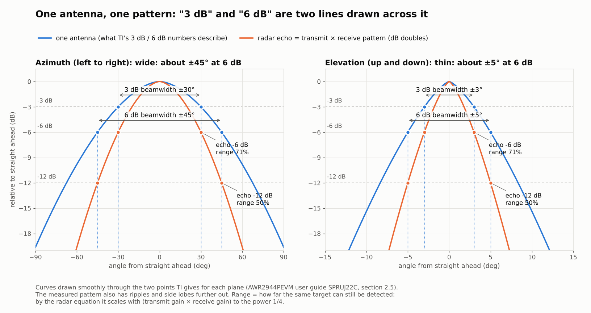

# 外壳会不会影响雷达信号

[English](radar-assessment.md) | 简体中文

2026-10-20 对 v3.0 新加的右墙和护板两个滑扣做的评估。它比较的是 v2.1 和 v3.0 的草稿（右墙顶端是 45° 斜顶），结论促成了 v3.0 正式版的竖直落下。

## 结论

**在 TI 给出的主波束里（6 dB 范围：方位 ±45°、俯仰 ±5°），右墙和两个滑扣不挡信号，也不会把能量反射进来，预计测不出差别。** 新材料离主波束边缘最近 31°，比 v2.0 起就在的护板天线窗下沿（17.5°）远得多。

能算出来的影响只有一处，在草稿上、视场的右下边缘：右墙 y 55 到 72 mm 那段 45° 斜顶像一面小镜子，会把天线往右下方很陡地发出的一点能量折向前方。按最保守的算法，它在 6 dB 波束里造成的起伏不超过 0.6 dB（峰峰值），在放宽到 ±60° × ±20° 的范围里不超过 1.7 dB，都比已有零件按同样算法得出的值小。把这段斜顶改成竖直落下，这条路径就没有了，滑扣、装法和滑扣测试件都不受影响，所以 v3.0 正式版就这样改了。

所以：主波束内可以放心；改成竖直落下以后，计算上找不到新增的影响。要真正确定，还需要实测，最后一节给了方法，目前还没做。

| 检查 | 结果 | 依据 |
| --- | --- | --- |
| 视线遮挡（35 个点，每点 32,041 个方向） | 6 dB 波束和 ±60° × ±20° 内都没有新挡住的方向；新挡住的方向都在俯仰 −10° 以下、方位 28° 以右 | 射线计算 |
| 离主波束的角度 | 新材料最近 31°；护板天线窗下沿 17.5° | 射线计算 |
| 第一菲涅耳区 | 6 dB 波束：让出 1.48 R1（竖直落下 1.85 R1），护板窗下沿 0.81 R1；±60° × ±20°：0.61 R1（竖直落下 0.65 R1）；都达到 0.6 R1 | ITU-R P.526 |
| 反射进视场 | 只有 45° 斜顶会；起伏上限 6 dB 波束 0.2 到 0.6 dB，±60° × ±20° 1.1 到 1.7 dB；竖直落下后为 0 | 几何光学估算 |
| 材料 | PLA εr 2.45 到 2.96，tanδ 约 0.01，单面反射约 −12 dB；新零件不在天线正前方，厚度规则用不上 | 4 篇测量文献，TI SWRA705 |
| 实测 | 还没做 | R&S、TI SPRACX7 |

## 天线的辐射范围

TI 的 AWR2944EVM / AWR2944PEVM 用户指南（SPRUJ22C 第 2.5 节）给出：板上天线峰值增益 13 dBi（76 到 81 GHz）；方位 3 dB 波束约 ±30°、6 dB 约 ±45°；俯仰 3 dB 约 ±3°、6 dB 约 ±5°。这一节的文字对 EVM 和 PEVM 都适用。

这次检查把要保持畅通的范围放宽到方位 ±60°、俯仰 ±20°：方位比 6 dB 宽度多 15°，俯仰是 6 dB 宽度的 4 倍。TI 只给到 6 dB 宽度，没有给出更外侧的方向图数值，所以这个余量是保守地取的。

天线位置取自 PEVM 的 PCB 文件（PROC194A）里的天线铜皮，在外壳坐标里是 x 90.45 到 120.45 mm、y 76 到 97.25 mm，在雷达板正面（z 40.6 mm）。下面的检查在这块区域上均匀取 35 个点作为发射点。

## 从天线看出去，新加的部分在哪里

做法：在天线铜皮上取 35 个点（横 7 个、竖 5 个），每个点向前方按 1° 步长发射线，方位和俯仰都从 −89° 到 89°，每个点 32,041 条，分别和 v2.1、v3.0 草稿的外壳本体加护板求交。用的就是打印用的 STL，没有简化。

- TI 的 6 dB 波束里，两版被挡的射线都是 0 条。
- 放宽的检查范围（±60° × ±20°）里，两版都是同样的 212 条被挡，全部来自 v2.0 起就有的护板天线窗下沿，它伸进了这个范围的右下角。草稿没有新增一条。
- 草稿新挡住的方向，全部在俯仰 −10° 以下、方位 28° 以右。改成竖直落下以后，只剩俯仰 −29° 以下的部分。
- 新材料离 6 dB 波束边缘最近 31°，离 ±60° × ±20° 的边缘最近 10°。作为对比，护板天线窗下沿离 6 dB 波束边缘只有 17.5°。新墙比一直都在的零件离主波束更远。

## 近场：菲涅耳区和反射

射线检查只回答“路上有没有东西”。外壳的墙离天线只有 1 到 5 cm，这个距离上还要看两件事：电磁波绕过边缘需要的空间（第一菲涅耳区），以及零件把能量反射回视场。

### 第一菲涅耳区

ITU-R P.526 的定义：路径上离发射点 d 处，第一菲涅耳区半径 R1 ≈ √(λd)（目标远大于 d 时）；这个椭球里没有障碍物，就算视距传播，衍射可以忽略；工程上要求障碍物至少让出 0.6 R1。取频段最低端 76 GHz（λ = 3.94 mm，R1 最大），d = 10 到 45 mm 时 R1 = 6.3 到 13.3 mm。

计算：在新材料表面取约 4 万个点，对天线上的 35 个点，求它到范围内最近一条射线的垂直距离 h，以及这条射线上对应的距离 d，取 h / R1 的最小值。

| 范围 | 新材料，草稿（45° 斜顶） | 新材料，竖直落下（v3.0） | 对比：已有零件 |
| --- | --- | --- | --- |
| TI 3 dB 波束 | 1.86 R1 | 2.28 R1 | 1.03 R1 |
| TI 6 dB 波束 | 1.48 R1 | 1.85 R1 | 0.81 R1（护板天线窗下沿） |
| ±60° × ±20° | 0.61 R1 | 0.65 R1 | 伸进范围里 |

都达到 0.6 R1，按 ITU-R P.526 不算衍射损耗。最紧的一处（0.61 R1）是右墙全高部分的上角，只对检查范围最外的角（方位 60°、俯仰 −20°）而言。这把尺子是为远场链路定的：这块天线约 37 mm 宽，远场从约 0.7 m 才开始，外壳在近场里，所以表里的数字用来比较远近，不当成精确的损耗。

### 反射

方法：几何光学。天线上 35 个点各自按 cos θ 到 cos² θ 的方向图辐射（θ 是偏离板面法线的角度；cos θ 比真实贴片天线更宽，会高估打到墙上的能量）。每条射线在第一次碰到的面上按镜面反射，反射率用 PLA（εr 2.7）单个表面在两种极化里较大的那个（TE）。把反射进各个范围的能量按 5° × 5° 分格，和这一格的直射能量比，最强的那一格给出起伏的上限：假设反射波和直射波完全同相叠加，峰峰值起伏 = 20 lg((1 + a)/(1 − a))，a 是幅度比。

| | 截获天线辐射的比例 | 6 dB 波束：最强格 / 起伏上限（峰峰值） | ±60° × ±20°：最强格 / 起伏上限 |
| --- | --- | --- | --- |
| 已有零件（v2.1） | 14% 到 21% | −23 到 −19 dB / 1.2 到 1.9 dB | −19 到 −18 dB / 2.0 到 2.3 dB |
| 新材料，草稿（45° 斜顶） | 0.3% 到 0.9% | −40 到 −29 dB / 0.2 到 0.6 dB | −24 到 −20 dB / 1.1 到 1.7 dB |
| 新材料，竖直落下（v3.0） | 0.2% 到 0.6% | 没有反射进来 / 0 | 没有反射进来 / 0 |

每格里两个数分别对应 cos² θ 和 cos θ 方向图。εr 取 2.45 或 2.96 时，各数变化不到 0.5 dB。已有零件的上限比新材料的还大，说明这个上限是保守的，适合拿来比较，不是预计会测到的值。

新材料送进视场的反射全部来自同一个面：右墙 y 55 到 72 mm 那段 45° 斜顶。天线往右下方很陡地发出去的射线（偏下 28° 到 78°）打到斜顶上，被折向前方，进入检查范围的部分落在方位 8° 到 60°、俯仰 0° 到 −20°。反射后的射线从护板右边缘外 9 mm 经过，护板挡不住它。墙的内侧面和两个滑扣的面都和波束方向平行或朝后，反射出去仍在视场外。把斜顶改成竖直落下，这些陡的射线从低矮的墙上方直接出去，这条反射路径就没有了。

**决定**：让右墙在 y 53.7 mm 处竖直落下，代替 y 55 到 72 mm 那段 45° 斜顶。53.7 mm 正好是下滑扣第二个入口槽的下沿（槽的间隙是 0.3 mm），这样墙端不会留下薄片。少用 0.38 cm³ 材料；滑扣、装护板的动作和护板受力都不变，滑扣测试件照样有效。改完重新算过：6 dB 波束让出 1.85 R1，±60° × ±20° 让出 0.65 R1，没有反射进视场，新挡住的方向都在俯仰 −29° 以下。

## PLA 在 77 GHz 附近是什么材料

| 来源 | 频率 | εr | tanδ | 备注 |
| --- | --- | --- | --- | --- |
| Işık 等，Aalto 大学（arXiv 预印本，2026） | 70 到 110 GHz | 2.45 到 2.75（7 种颜色的 Ultimaker PLA） | 银色 PLA 在高频超过 0.02 | 没有观察到各向异性；未经同行评审 |
| Felício、Fernandes、Costa（ICECom 2016） | 0.5 到 60 GHz | 约 2.75 ± 0.05（垂直于打印面），约 2.96（平行） | (1.1 ± 0.2) × 10⁻² | 约 7% 各向异性；只看到摘要 |
| Hagström 等（LAPC 2018） | 60 GHz | 2.74 | | 只看到数据集记录 |
| Jeong、Ghalichechian（IEEE AP-S 2018） | 30 GHz（THz 测量加模型） | 2.86 | 0.01 | 模型值，仅作参考 |

对这次问题的意义：

- PLA 是低介电常数、略有损耗的塑料，不是金属。单个表面正入射时反射约 6% 的功率（εr 2.7 时约 −12 dB；εr 2.45 到 2.96 时 −13 到 −11.5 dB），斜入射时 TE 极化会变强。上一节的反射估算就是用这个值。
- TI 的天线罩设计指南（SWRA705）里的半波长厚度规则（壁厚取 nλm/2，77 GHz 下 λm/2 约 1.13 到 1.24 mm）是给挡在天线正前方的盖子用的。护板在天线前面开着窗，新加的部分在侧面，这条规则用不上。2.4 mm 的墙恰好约等于两个半波长，但只对正入射成立。
- 损耗：tanδ 0.01 时，2.4 mm 厚的 PLA 单程约 0.3 dB。新零件不在波束里，这个数也用不上。
- TI 同一份指南提醒金属件不要伸进视场。外壳里的螺丝头都在雷达板面上、离天线很远，从天线看偏离法线 85° 以上，不在视场里。
- 护板和右墙不要用银色、金属粉或碳纤维的 PLA 打：银色 PLA 的损耗在 7 种颜色里最高，导电填料只会更像金属。普通纯色 PLA 没问题。

## 还不确定的地方，以及怎样测出来

上面的结论来自几何计算，没有做全波电磁仿真（Infineon 的雷达设计指南建议外壳用 EM 仿真找视场里的凹口）。主要的不确定：

- 外壳在天线近场里，射线、菲涅耳区和镜面反射都是近似。新墙的特征只有几个波长大小，实际是散射，不是干净的镜面反射，能量会散得更开。
- TI 只给了 3 dB 和 6 dB 波束宽度，更外侧的方向图不知道，所以用 cos θ 和 cos² θ 两种假设把它框住。
- 刀刃衍射模型里，离射线 1 到 2 个 R1 的长直边仍会带来 ±1 dB 量级的起伏。这类边缘护板天线窗下沿一直就有，而且离主波束更近；新墙离得更远。
- 不同颜色、品牌和打印方向的 PLA，εr 在 2.45 到 2.96 之间，对结果的影响不到 0.5 dB。
- 发射到接收的近距离耦合（TI 说的距离很近的几个 bin 里、在 DC 附近出现的天线耦合信号）主要来自朝后的面。新零件朝后的面只有滑扣底端大约 20 mm²，比护板下半部分小两个数量级以上，预计看不出来。

### 实测方法（约 15 分钟，还没做）

做法和 Rohde & Schwarz 检查汽车雷达罩的一样：在固定的距离和方位放角反射器，分别测两种状态下的回波电平，只看差值。这里的两种状态是同一套板子装在两个外壳里，比如从一个外壳换到另一个时顺便测。

1. 准备一个角反射器。没有的话，用三块 8 到 10 cm 见方的硬纸板贴铝箔，互相垂直粘成一个角。放在约 2 m 远、和雷达同高的地方，周围 1 m 内不要有别的大件物体。
2. 雷达装在第一个外壳里、盖好护板，放在三脚架上。用 TI mmWave Demo Visualizer 的 Range Profile 图（或 mmWave Studio 加 DCA1000 录数据）读出角反射器那个峰的 dB 值，配置和增益设置保持不变。
3. 在 0°、向右 20°、40°、55° 四个方位各测 3 次（每次把雷达转开再转回来）。新墙在右边，只测右边就够。再把雷达往上仰约 15°，方位 0° 和 40° 各测一次，这时反射器落在视场下方，正好是 45° 斜顶可能影响的区域。
4. 同时记下距离 0 到 15 cm 那几个 bin 的电平，这是发射到接收的近距离耦合。
5. 把板子换到第二个外壳里，在同一位置、用同样的设置重复一遍。

判定：每个方位上，两个外壳的峰值差小于同一外壳 3 次之间的差，或者小于 1 dB；近距离那几个 bin 没有出现新的峰。按雷达方程，回波弱 1 dB 大约让最大距离缩短 6%；R&S 给的例子是双程损耗 3 dB 对应 16%。

## 来源

来源列表和英文版相同，见 [radar-assessment.md](radar-assessment.md) 的 Sources 一节。计算用的是 v2.1 和 v3.0 草稿的打印 STL。
