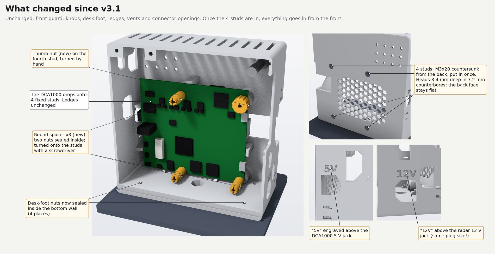
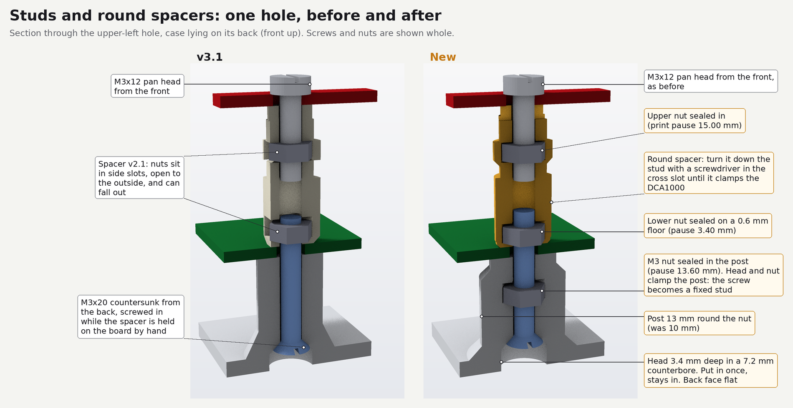
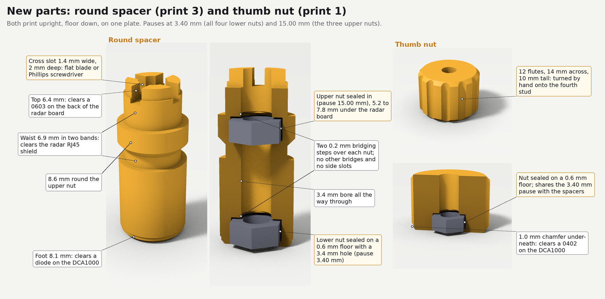
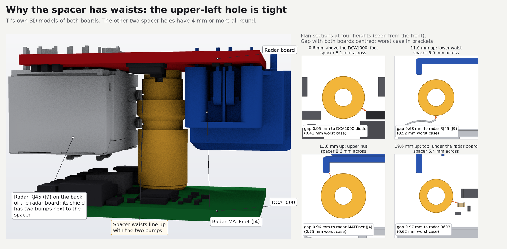
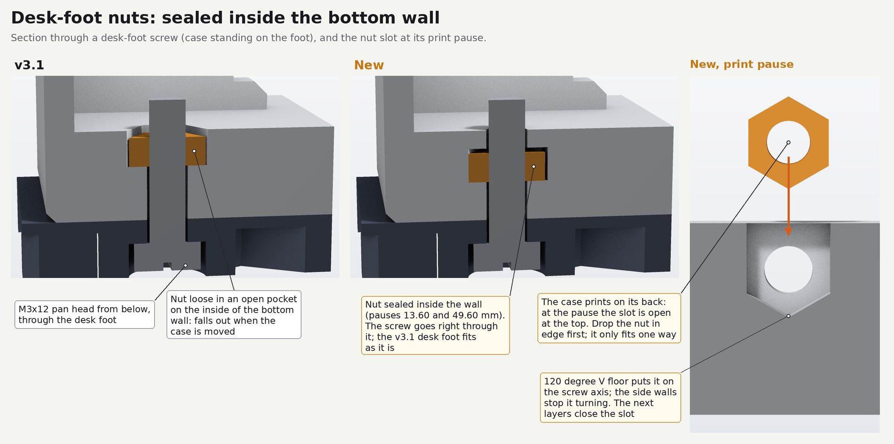

# Why v3.2 changed what it changed

English | [简体中文](v3.2-changes.zh-CN.md)

Design decisions of 2026-11-03, test printed with the settings in the README in November 2026.

v3.1 had three problems. The small printed spacers came out inaccurate (the bridged roofs of their
nut slots sagged, they strung, and they deformed from heat); the nuts fell out of the spacer side
slots; and assembly was fiddly: screws went in from the back while each spacer was held on the
DCA1000 by hand, the fourth DCA1000 hole needed a nut held with pliers on the front, and the floor
nuts for the desk foot were loose.

Assembly guidelines say the same thing a laptop does: put everything in along one axis, from above,
without turning the work over, and make every part stay put as soon as it is placed. Rolls-Royce's
DFMA guide lists "Assemble in single axis (from above)", "Screw down from above", "Avoid
reorientation" and asks whether a part must be held down to keep its place; the Boothroyd-Dewhurst
rules say the same. Brass male-female standoffs would do it, but they could not be bought, there were
no screws longer than M3×20 for a through bolt, and no temperature-controlled iron for heat-set
inserts. v3.2 does it with the screws already in the kit.

Unchanged: outer dimensions, front guard, knobs, desk foot, ledges, vents and connector openings.
In TI's 3 dB and 6 dB beams nothing new blocks or reflects the signal (section 7).

## 1. Studs instead of back screws

The four back M3×20 countersunk screws become studs. Each one goes in once from the back, through an
M3 nut sealed in its post; head and nut clamp the post, so the screw cannot turn later. The DCA1000
then drops onto the four studs, and everything after that is screwed onto them from the front.

- Head: a 7.2 mm counterbore 3.4 mm deep, then a 90° seat down to the 3.4 mm hole at 5.3 mm. In v3.1
  the head already sat 2.6 to 3.2 mm deep in a 6.8 mm counterbore; v3.2 sits 3.6 to 4.2 mm deep,
  1.0 mm deeper, so the stud reaches through a spacer's lower nut. The back face stays flat, and the case lies on it during
  assembly.
- Post nut: a hex pocket 5.8 mm across flats, 2.8 mm deep, at 10.6 to 13.4 mm above the back face,
  sealed by two 0.2 mm bridging steps (a channel, then a square) and 4.0 mm of post above.
- Post: 13 mm instead of 10 mm up to 14.4 mm, with a 45° root flare, stepping back to 10 mm by
  15.9 mm. At the nut corners the wall is 3.15 mm instead of 1.65 mm. The nearest DCA1000 underside
  part is 3.8 mm from the thick part; the nearest ledge 2.0 mm from the flare.

The stud tip depends on screw length and head size (ISO 10642 heads are 5.54 to 6.72 mm across, and
smaller heads sit deeper). Heights above the back face; the DCA1000 front face is at 19.0 mm.

| Screw length | 6.72 mm head | 6.0 mm head | 5.54 mm head |
| --- | --- | --- | --- |
| 19.5 mm | 23.14 mm | 23.50 mm | 23.73 mm |
| 20.5 mm | 24.14 mm | 24.50 mm | 24.73 mm |

So 4.1 to 5.7 mm of stud stands in front of the DCA1000.

## 2. Round spacers with sealed nuts

The spacer turns as it is screwed onto the stud and stops at a random angle, so it is round: every
height clears the parts around it at every angle. Two M3 nuts sit on its axis, sealed in at print
pauses: the lower one at 0.6 to 3.2 mm above a 0.6 mm floor with a 3.4 mm hole, the upper one at
12.2 to 14.8 mm. The only bridges are the two 0.2 mm steps over each nut; there are no side slots.
A cross slot in the top, 1.4 mm wide and 2.0 mm deep, takes a flat blade up to 1.2 mm thick or a
Phillips bit.

- Lower nut: its top is at 22.0 mm; the stud passes it by 1.14 to 2.73 mm.
- Upper nut: 5.2 to 7.8 mm below the radar board. The radar board is 1.44 mm thick (56.57 mil ±10 %
  in TI's SPRR507 fab notes), so the M3×12 tip sits at 28.29 to 28.58 mm: through the upper nut by at
  least 2.6 mm and 3.56 to 5.44 mm short of the stud tip. An M3×20 there would hit the stud.

The outline, from the bottom: 7.2 mm rising at 45° to 8.1 mm, then 8.4 mm, a 6.9 mm waist from 10.1
to 11.65 mm, 8.6 mm round the upper nut up to 15.0 mm, 6.9 mm up to 18.6 mm, and 6.4 mm for the top
1.4 mm. The waists are for the upper left hole, the tight one:

Worst clearances, through a full turn, with both boards at the ends of their play:

| Hole | Worst clearance | Nearest part |
| --- | --- | --- |
| lower left | 4.21 mm | radar CAN terminal pins |
| lower right | 6.01 mm | radar header pins |
| upper left, foot | 0.41 mm (0.95 mm with the board centred) | DCA1000 diode NAUO116 |
| upper left, 10.3 to 11.95 and 15.2 to 16.9 mm up | 0.52 mm | radar RJ45 (J9) shield |
| upper left, top | 0.62 mm | 0603 capacitor on the back of the radar board |
| upper left, round the upper nut | 0.75 mm | radar MATEnet (J4) |

At the upper left hole the radar parts would also have to sit 0.32 mm lower or 0.60 mm higher than in
TI's model before they touched the spacer.

The printed dummy boards are coarser: their RJ45 block is the outline of the whole connector, so at the
upper left hole it overlaps the spacer by 0.05 mm, 12.5 mm above the DCA1000. A dry fit with the
dummies rubs there; the real board leaves 0.75 mm. Elsewhere the dummies leave at least 1.4 mm.

## 3. Thumb nut on the fourth hole

The fourth DCA1000 hole has no radar board hole above it. A printed thumb nut, 14 mm across with 12
flutes and 10 mm tall, turns onto that stud by hand; its nut and floor are the same as the spacer's
lower ones. A 1.0 mm chamfer underneath clears a 0402 on the DCA1000, which is the worst clearance at
1.0 mm. Above it there is 10.0 mm to the radar board, and no radar part comes within 9.6 mm of its
axis.

## 4. Desk-foot nuts sealed in the floor

The four nuts now sit inside the 7.5 mm floor. The case prints on its back, so these screws run
parallel to the bed and each nut stands on its edge: it drops into a slot 5.8 mm wide and 2.8 mm thick,
a 120° V floor puts it on the screw axis, and the slot walls stop it turning. The roof is 0.2 mm above
the nut's top corner. The old open pockets are closed. The hole positions are unchanged, so the v3.1
desk foot fits; the M3×12 goes through the nut and 4.4 mm past it.

Nothing is loose inside any more, so the desk foot goes on last.

The 1/4"-20 tripod nut stays a loose nut in its pocket: the tripod is rarely used. With both boards in,
the pocket is reached with tweezers (in left of the radar board about 40 mm above the floor, back
between the boards about 7 mm behind the radar board, 30 mm right, 25 mm down), with at least 1.0 mm
all round at the narrowest point.

## 5. "5V" and "12V"

The radar board takes 12 V and the DCA1000 5 V, through the same barrel plug size, and 12 V in the
DCA1000 destroys it. "5V" is engraved above the left wall's lower rear window (DCA1000 J2), "12V" above
the right wall's lowest front window (radar J12): 0.6 mm deep, digits 5.1 mm tall, strokes about 1 mm.
Engraved rather than raised: Materialise's FDM guidelines ask for at least 1 mm lines and 0.3 mm depth
for engraved text, but 2.5 mm lines for raised text.

## 6. Print pauses

| Part | Pause | Layer | Nuts |
| --- | --- | --- | --- |
| body | 13.60 mm | 68 | 4 post nuts (flat), 2 back-row floor nuts (on edge) |
| body | 47.00 mm | 235 | 2 knob nuts, as in v3.1 |
| body | 49.60 mm | 248 | 2 front-row floor nuts (on edge) |
| spacer plate | 3.40 mm | 17 | 3 lower spacer nuts and the thumb nut's nut |
| spacer plate | 15.00 mm | 75 | 3 upper spacer nuts |

Each pause is at the first layer above its pockets (0.20 mm layers). The front-row floor slots cannot
share the 47.00 mm pause: they are already open then, but a nut put in would stand 2.4 mm above the
print.

## 7. Ledges and the antenna

**Ledges.** In TI's CAD the DCA1000 holes are 4.32 mm, so on M3 studs the board has 0.66 mm of radial
play. The ledges allow ±0.4 mm, inside that play, so they cannot fight the studs, and they keep the
board from floating: with the studs alone, the closest spacer clearance would drop from 0.41 to
0.29 mm. The ledges are unchanged.

**Antenna.** All material added to the body lies within 15.9 mm of the back face or inside the floor.
The new parts end below the radar board: spacer tops at 39.0 mm, thumb nut at 29.0 mm, stud tips at
24.7 mm at most. The ray check from 35 points over the antenna area gives the same blocked-ray counts
for v3.1 and v3.2:

| Box | Blocked rays, v3.1 and v3.2 |
| --- | --- |
| 6 dB, ±45° × ±5° | 0 |
| ±60° × ±20° | 206 |
| ±75° × ±30° | 20159 |

Only 93 rays differ, all 77° to 87° below boresight, where they now hit the floor where the front
floor-nut pockets used to open. The "12V" label only removes material and lies 88° to 90° below
boresight.

## 8. Mixing with v3.1 parts

The new body still takes a v3.1 spacer with an M3×20 from the back: the screw threads through the post
nut, and its tip at 23.14 to 24.73 mm passes the v3.1 spacer's lower nut by at least 0.74 mm, 6.4 mm
short of its upper nut. The v3.1 fourth-hole screw and plain nut also still work. Front guard, knobs
and desk foot are unchanged. A body that still takes the previous version's parts is a minor version,
so this is v3.2.

## Board models

All clearances come from TI's own 3D models, not the block dummies:

- DCA1000EVM: SPRR350 `PROC048A_STEP`, every part down to the 0402s.
- AWR2944PEVM: the AWR2944EVM model from SPRR440 (`PROC113D_BRD.step`) with the 9 parts the P board
  does not fit removed (not fitted in its BOM, or no pads in its Gerbers). Within 12 mm of each hole,
  every bottom-side paste pad and pin hole in the AWR2944PEVM's own Gerbers (SPRR507, PROC194A) lies
  under a part of that model.
- Positions: the DCA1000 anywhere within the ledges (±0.4 mm); the radar board at any offset that keeps
  its three 4.064 mm holes round M3 screws on the stud axes (dx −0.36 to 0.36 mm, dy 0.22 to 0.53 mm).
  The clearances above are the worst cases over both.

## Sources

- [Rolls-Royce, How to Design for Manufacture and Assembly](https://www.rolls-royce.com/~/media/Files/R/Rolls-Royce/documents/sustainability/value-chain-competitiveness/7-vcc-how-to-design-for-manufacture-and-assembly.pdf),
  [Boothroyd-Dewhurst DFA guidelines, reproduced](http://nraoiekc.blogspot.com/2021/11/dfma-design-for-assembly-guidelines.html).
- 12 V and 5 V on the same plug size: [xwr setup notes](https://radarml.github.io/xwr/setup).
- Engraved text: [Materialise, FDM design guidelines](https://www.materialise.com/en/academy/industrial/design-am/pc-iso).
- Pauses need print sequence "By layer": [Bambu Studio issue 2912](https://github.com/bambulab/BambuStudio/issues/2912).
- Board models: TI [SPRR350](https://www.ti.com/lit/zip/SPRR350), [SPRR440](https://www.ti.com/lit/zip/SPRR440),
  [SPRR507](https://www.ti.com/lit/zip/SPRR507).
- Antenna checks: [radar-assessment.md](radar-assessment.md).
