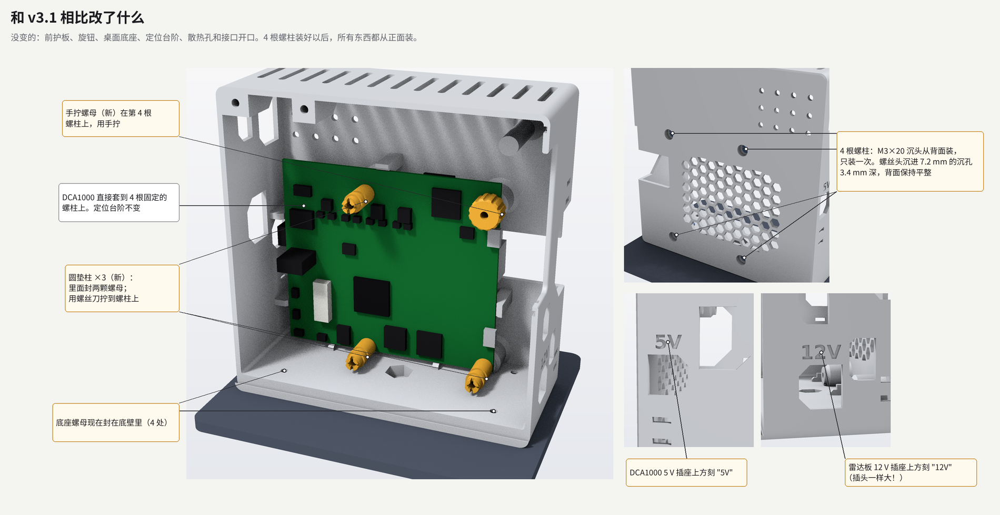
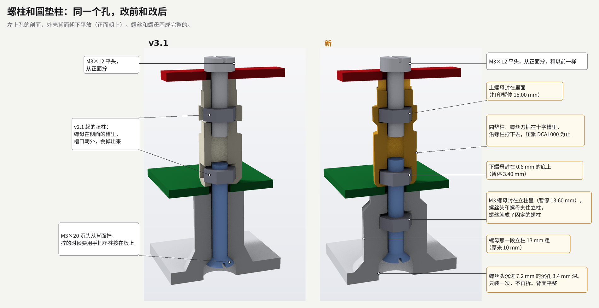
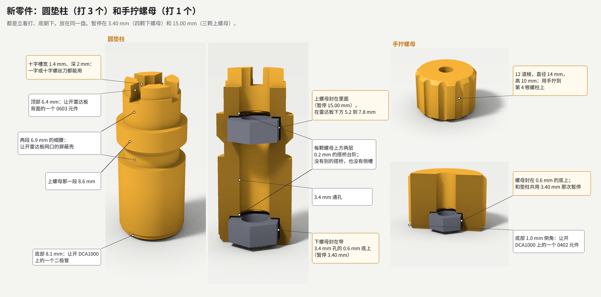
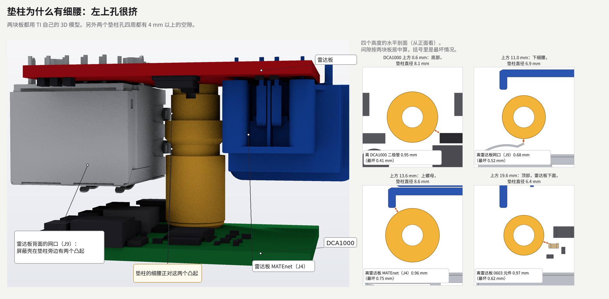
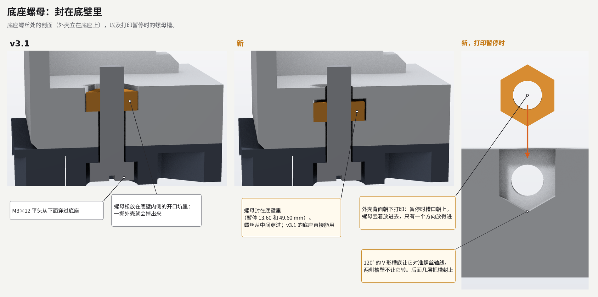

# v3.2 为什么这样改

[English](v3.2-changes.md) | 简体中文

2026-11-03 定的设计，2026 年 11 月按 README 里的设置试打验证过。

v3.1 有三个问题：打印的小垫柱不准（螺母槽上方的搭桥会塌、拉丝、受热变形）；螺母会从垫柱侧面的槽里掉出来；装起来很麻烦：从背面拧螺丝时要用手把每根垫柱按在 DCA1000 上，DCA1000 第 4 个孔要用钳子在正面捏住螺母，底座用的底壁螺母也是松的。

装配设计规范和笔记本电脑的做法是一回事：所有零件沿一个方向、从上往下装，中途不翻转，零件放上去就固定住。Rolls-Royce 的 DFMA 指南写着"Assemble in single axis (from above)""Screw down from above""Avoid reorientation"，还要问零件是否需要按住才能保持位置；Boothroyd-Dewhurst 的规则也是这样。用公母铜柱就能做到，但买不到；也没有比 M3×20 更长的螺丝可以一穿到底；没有可调温烙铁，热熔铜螺母也用不了。v3.2 只用套件里已有的螺丝做到了这一点。

没变的：外形尺寸、前护板、旋钮、桌面底座、定位台阶、散热孔和接口开口。在 TI 给出的 3 dB 和 6 dB 波束里，没有新增遮挡或反射（第 7 节）。

## 1. 用螺柱代替背面螺丝

背面那 4 颗 M3×20 沉头变成螺柱：每颗从背面装一次，穿过封在立柱里的 M3 螺母，螺丝头和螺母夹住立柱，以后螺丝就不会再转。DCA1000 直接套到 4 根螺柱上，之后所有东西都从正面拧到螺柱上。

- 螺丝头：7.2 mm 的沉孔深 3.4 mm，下面是 90° 的锥座，到 5.3 mm 处收成 3.4 mm 的孔。v3.1 的螺丝头本来就沉进 2.6 到 3.2 mm（6.8 mm 沉孔，深 2.6 mm）；v3.2 沉进 3.6 到 4.2 mm，再深 1.0 mm，螺柱才够得着垫柱里的下螺母。背面保持平整，装配时外壳就躺在这一面上。
- 立柱螺母：对边 5.8 mm、深 2.8 mm 的六角坑，在离背面 10.6 到 13.4 mm 处，上面先是两层 0.2 mm 的搭桥台阶（先一条槽，再一个方形），再上面是 4.0 mm 厚的立柱。
- 立柱：14.4 mm 以下从 10 mm 加粗到 13 mm，根部有 45° 的过渡，到 15.9 mm 处退回 10 mm。螺母角那里的壁厚从 1.65 mm 增加到 3.15 mm。离加粗段最近的 DCA1000 背面元件有 3.8 mm，最近的定位台阶离根部过渡 2.0 mm。

螺柱尖的位置取决于螺丝长度和头的大小（ISO 10642 的头径在 5.54 到 6.72 mm 之间，头越小沉得越深）。高度从背面量起；DCA1000 正面在 19.0 mm。

| 螺丝长度 | 头径 6.72 mm | 头径 6.0 mm | 头径 5.54 mm |
| --- | --- | --- | --- |
| 19.5 mm | 23.14 mm | 23.50 mm | 23.73 mm |
| 20.5 mm | 24.14 mm | 24.50 mm | 24.73 mm |

所以螺柱伸出 DCA1000 正面 4.1 到 5.7 mm。

## 2. 圆垫柱，螺母封在里面

垫柱要转着拧到螺柱上，停在哪个角度是随机的，所以做成圆的：每个高度在任何角度都能让开周围的元件。两颗 M3 螺母在它的轴线上，打印暂停时封进去：下螺母在 0.6 到 3.2 mm，下面是带 3.4 mm 孔的 0.6 mm 底；上螺母在 12.2 到 14.8 mm。唯一的搭桥是每颗螺母上方的两层 0.2 mm 台阶，没有侧槽。顶上的十字槽宽 1.4 mm、深 2.0 mm，厚度 1.2 mm 以内的一字刀头或十字刀头都能用。

- 下螺母：顶面在 22.0 mm，螺柱穿过它 1.14 到 2.73 mm。
- 上螺母：在雷达板下方 5.2 到 7.8 mm。雷达板厚 1.44 mm（TI SPRR507 的加工说明里是 56.57 mil ±10%），所以 M3×12 的螺丝尖在 28.29 到 28.58 mm：穿过上螺母至少 2.6 mm，离螺柱尖还有 3.56 到 5.44 mm。这里用 M3×20 会顶到螺柱。

外形从下往上：7.2 mm 按 45° 放大到 8.1 mm，然后是 8.4 mm，10.1 到 11.65 mm 是 6.9 mm 的细腰，上螺母那一段 8.6 mm 到 15.0 mm，再往上 6.9 mm 到 18.6 mm，最上面 1.4 mm 是 6.4 mm。细腰是为了左上那个最挤的孔：

转一整圈、两块板都推到活动范围的极限时，最小间隙：

| 孔 | 最小间隙 | 最近的元件 |
| --- | --- | --- |
| 左下 | 4.21 mm | 雷达板 CAN 端子的针脚 |
| 右下 | 6.01 mm | 雷达板排针 |
| 左上，底部 | 0.41 mm（板子居中时 0.95 mm） | DCA1000 的二极管 NAUO116 |
| 左上，DCA1000 上方 10.3 到 11.95 mm 和 15.2 到 16.9 mm | 0.52 mm | 雷达板网口（J9）的屏蔽壳 |
| 左上，顶部 | 0.62 mm | 雷达板背面的 0603 电容 |
| 左上，上螺母那一段 | 0.75 mm | 雷达板 MATEnet（J4） |

另外，左上孔附近的雷达板元件要比 TI 模型里低 0.32 mm 或高 0.60 mm，才会碰到垫柱。

打印的假体板比较粗糙：它的网口方块是整个插座的外轮廓，所以在左上孔、DCA1000 上方 12.5 mm 处和垫柱重叠 0.05 mm。用假体板试装时这里会蹭；真板在这里留有 0.75 mm。其他地方假体板至少留 1.4 mm。

## 3. 第 4 个孔的手拧螺母

DCA1000 的第 4 个孔上方，雷达板没有孔。这里用一个打印的手拧螺母，直径 14 mm、12 道棱、高 10 mm，用手拧到螺柱上；里面的螺母和底与垫柱的下部一样。底部 1.0 mm 的倒角让开 DCA1000 上的一个 0402 元件，这也是它最小的间隙，1.0 mm。上方离雷达板还有 10.0 mm，雷达板的元件离它的轴线都在 9.6 mm 以外。

## 4. 底座螺母封进底壁

4 颗螺母现在封在 7.5 mm 厚的底壁里。外壳背面朝下打印，这几颗螺丝和打印板平行，所以螺母是竖着放的：它落进一个宽 5.8 mm、厚 2.8 mm 的槽，槽底 120° 的 V 形让它对准螺丝轴线，两侧槽壁不让它转。槽顶比螺母上面的角高 0.2 mm。原来开口的坑已经封死。孔的位置不变，所以 v3.1 的底座直接能用；M3×12 穿过螺母还多出 4.4 mm。

外壳里再也没有松的螺母，所以底座可以最后装。

三脚架的 1/4"-20 螺母仍然松放在坑里：三脚架很少用。两块板都装好时，用镊子能把它送到坑里（从雷达板左边、离底壁约 40 mm 处伸进去，往里走到两块板之间、雷达板后面约 7 mm，往右 30 mm，再往下 25 mm），最窄处四周至少有 1.0 mm。

## 5. "5V" 和 "12V"

雷达板要 12 V，DCA1000 要 5 V，两个插头一样大，12 V 插进 DCA1000 会把它烧坏。左侧壁靠后偏下的窗口（DCA1000 J2）上方刻 "5V"，右侧壁最下面靠前的窗口（雷达板 J12）上方刻 "12V"：深 0.6 mm，字高 5.1 mm，笔画约 1 mm。用凹刻而不是凸起：Materialise 的 FDM 设计规范要求凹刻文字的笔画至少 1 mm、深 0.3 mm，凸起文字的笔画却要 2.5 mm。

## 6. 打印暂停

| 零件 | 暂停 | 层 | 螺母 |
| --- | --- | --- | --- |
| 外壳本体 | 13.60 mm | 68 | 4 颗立柱螺母（平放），2 颗底壁后排螺母（竖放） |
| 外壳本体 | 47.00 mm | 235 | 2 颗旋钮螺母，和 v3.1 一样 |
| 外壳本体 | 49.60 mm | 248 | 2 颗底壁前排螺母（竖放） |
| 垫柱盘 | 3.40 mm | 17 | 3 颗垫柱下螺母和手拧螺母里的螺母 |
| 垫柱盘 | 15.00 mm | 75 | 3 颗垫柱上螺母 |

每次暂停都在螺母坑上方的第一层（层高 0.20 mm）。底壁前排的槽没法和 47.00 mm 那次共用：那时槽已经露出来了，但放进去的螺母会高出打印面 2.4 mm。

## 7. 定位台阶和天线

**定位台阶。** TI 的 CAD 里 DCA1000 的孔是 4.32 mm，所以套在 M3 螺柱上，板子有 0.66 mm 的径向活动量。定位台阶留的间隙是 ±0.4 mm，在这个活动量以内，不会和螺柱抢着定位，还能限制板子晃动：只靠螺柱的话，垫柱最小间隙会从 0.41 mm 降到 0.29 mm。定位台阶没改。

**天线。** 外壳本体新增的材料都在离背面 15.9 mm 以内，或者在底壁里面。新零件都在雷达板后面：垫柱顶在 39.0 mm，手拧螺母顶在 29.0 mm，螺柱尖最高 24.7 mm。从天线区域 35 个点重新做射线检查，v3.1 和 v3.2 被挡住的射线数完全一样：

| 范围 | 被挡射线数，v3.1 和 v3.2 |
| --- | --- |
| 6 dB，±45° × ±5° | 0 |
| ±60° × ±20° | 206 |
| ±75° × ±30° | 20159 |

只有 93 条射线不同，都在正前方以下 77° 到 87°，现在打在原来底壁前排螺母坑开口的地方。"12V" 是凹刻，只去掉材料，而且在正前方以下 88° 到 90°。

## 8. 和 v3.1 的零件混用

新本体仍然能装 v3.1 的垫柱加背面 M3×20：螺丝穿过立柱螺母，螺丝尖在 23.14 到 24.73 mm，穿过 v3.1 垫柱的下螺母至少 0.74 mm，离它的上螺母还有 6.4 mm。v3.1 第 4 个孔的螺丝加普通螺母也照样能用。前护板、旋钮、桌面底座都没变。按规则，新本体还能用上一版的零件就只升小版本，所以是 v3.2。

## 板子模型

所有间隙都按 TI 自己的 3D 模型算，不是方块假体：

- DCA1000EVM：SPRR350 的 `PROC048A_STEP`，包括所有元件，小到 0402。
- AWR2944PEVM：SPRR440 里 AWR2944EVM 的模型（`PROC113D_BRD.step`），去掉了 P 板上不装的 9 个元件（BOM 里标为不装，或者 Gerber 里没有焊盘）。每个孔 12 mm 以内，AWR2944PEVM 自己的 Gerber（SPRR507，PROC194A）里背面的每个钢网焊盘和插件孔，都落在这个模型的某个元件下面。
- 位置：DCA1000 在定位台阶以内任意位置（±0.4 mm）；雷达板在三个 4.064 mm 的孔都套着螺柱轴线上的 M3 螺丝的范围内任意偏移（dx −0.36 到 0.36 mm，dy 0.22 到 0.53 mm）。上面的间隙都是这两者的最坏情况。

## 参考资料

- [Rolls-Royce, How to Design for Manufacture and Assembly](https://www.rolls-royce.com/~/media/Files/R/Rolls-Royce/documents/sustainability/value-chain-competitiveness/7-vcc-how-to-design-for-manufacture-and-assembly.pdf)，[Boothroyd-Dewhurst 装配设计规则（转载）](http://nraoiekc.blogspot.com/2021/11/dfma-design-for-assembly-guidelines.html)。
- 12 V 和 5 V 插头一样大：[xwr setup notes](https://radarml.github.io/xwr/setup)。
- 凹刻文字：[Materialise, FDM design guidelines](https://www.materialise.com/en/academy/industrial/design-am/pc-iso)。
- 暂停要求打印顺序为 "By layer"：[Bambu Studio issue 2912](https://github.com/bambulab/BambuStudio/issues/2912)。
- 板子模型：TI [SPRR350](https://www.ti.com/lit/zip/SPRR350)、[SPRR440](https://www.ti.com/lit/zip/SPRR440)、[SPRR507](https://www.ti.com/lit/zip/SPRR507)。
- 天线检查：[radar-assessment.zh-CN.md](radar-assessment.zh-CN.md)。
